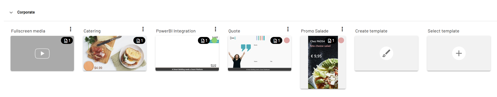

CMS 2.0 is a web-based content management system for digital signage. You use it to create, organize, and publish content on many screens.

## How CMS 2.0 works

CMS 2.0 separates design from content. Designers create templates, and editors add messages to those templates. Because the tasks are separate, designers and editors can work at the same time.

<Frame caption="A template in CMS 2.0">
  
</Frame>

## Roles and permissions

Administrators assign roles and permissions to control who can edit, schedule, or publish specific categories, templates, and messages.

You can also assign a template to specific Viewers. Only those Viewers can then use the layout, and only users with permission can schedule it.

## Scheduling

Schedules in CMS 2.0 use priorities. A message with a higher priority overrides normal content, so urgent messages play first. For each screen, you can see what is playing and what is scheduled.

## Live data

CMS 2.0 connects to data sources such as OData and RSS feeds. Live information, for example news, weather, or stock prices, appears automatically in your messages.

## Related

- [PADS4 Digital Signage manual](/digital-signage/introduction)
