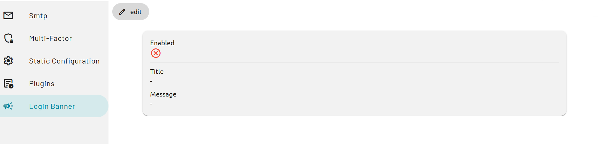
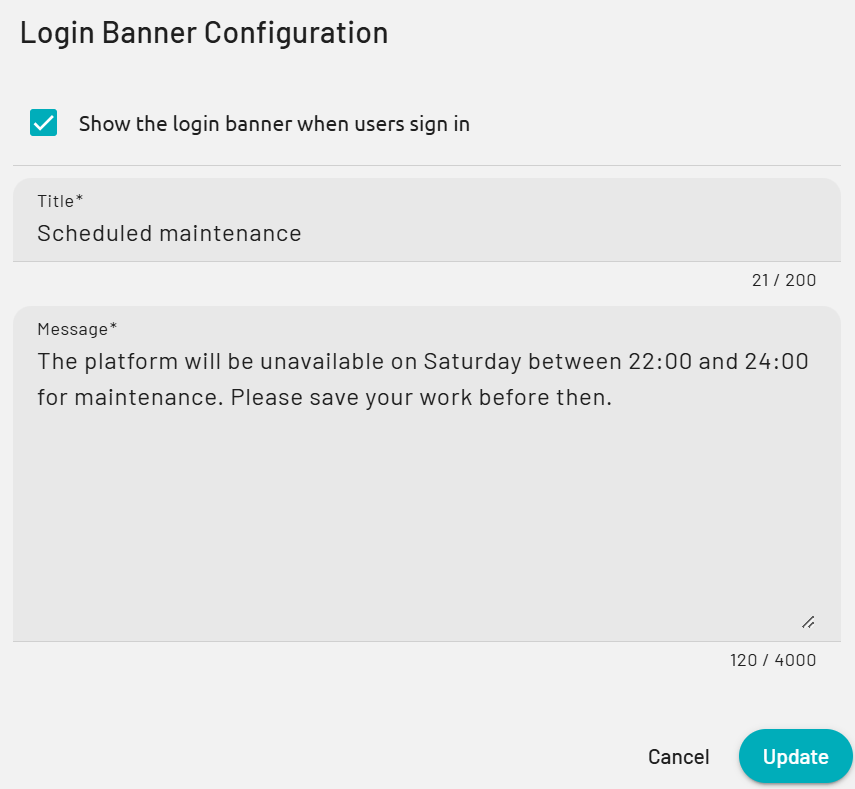
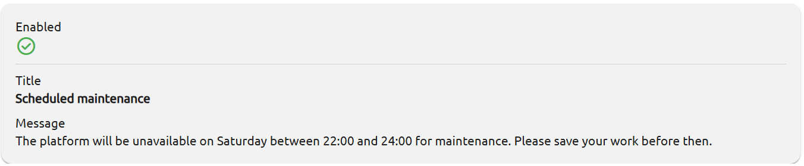

The login banner shows a title and a message to users when they sign in to PADS4. Use it for announcements that every user must see, such as planned maintenance or a change in policy. You set up the banner in PADS4 CTRL Center.

## Before you begin

- You need access to the **Config** application in PADS4 CTRL Center.
- Decide on the title (up to 200 characters) and the message (up to 4000 characters). All users see the banner, so check the text before you save it.

## Set up the login banner

<Steps>
  <Step title="Open the Login Banner page">
    In PADS4 CTRL Center, open the application menu and select **Config**. In the navigation on the left, select **Login Banner**.

    <Frame caption="The Login Banner page before you set up the banner">
      
    </Frame>
  </Step>
  <Step title="Open the settings">
    Select **edit**. The **Login Banner Configuration** dialog opens.

    <Frame caption="The Login Banner Configuration dialog">
      
    </Frame>
  </Step>
  <Step title="Enter the banner text">
    1. Select **Show the login banner when users sign in**.
    2. In **Title**, enter a short title. For example: `Scheduled maintenance`.
    3. In **Message**, enter the text that users must read. For example: `The platform will be unavailable on Saturday between 22:00 and 24:00 for maintenance. Please save your work before then.`

    The counters under the fields show how many characters you used.

    <Frame caption="The dialog with the example banner">
      
    </Frame>
  </Step>
  <Step title="Save the banner">
    Select **Update**. PADS4 shows the message **Changes saved successfully.**
  </Step>
</Steps>

## Change or remove the banner

- To change the text, select **edit**, change the **Title** or **Message**, and select **Update**.
- To stop showing the banner, select **edit**, clear **Show the login banner when users sign in**, and select **Update**. PADS4 keeps the title and message.

To close the dialog without saving, select **Cancel**.
