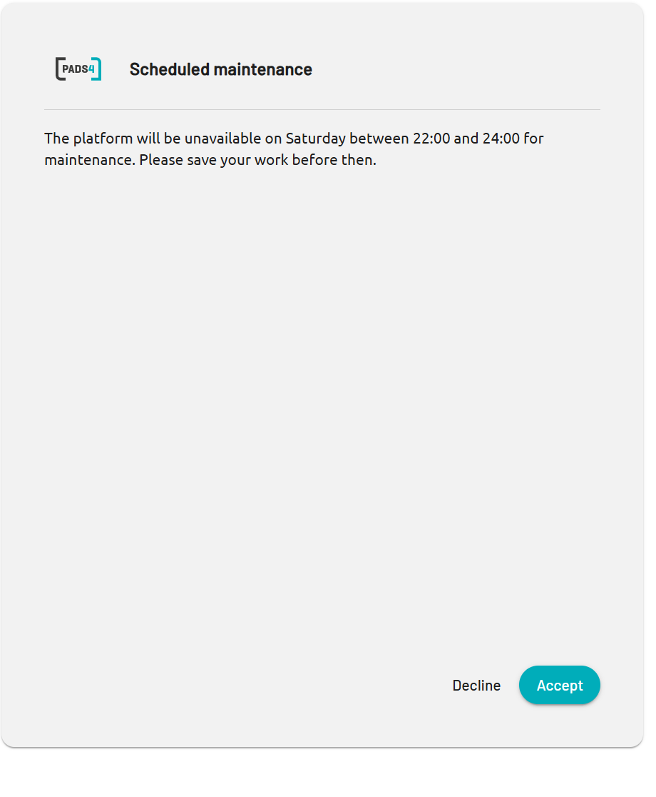

When you sign in to PADS4, your administrator can show you a message. This message is the login banner. Administrators use it for announcements that everyone must know, such as planned maintenance or a change in policy.

## What you see

The login banner has a title and a message. For example:

<table>
  <colgroup>
    <col width="100" />
    <col width="553" />
  </colgroup>
  <thead>
    <tr>
      <th>Part</th>
      <th>Example</th>
    </tr>
  </thead>
  <tbody>
    <tr>
      <td>**Title**</td>
      <td>Scheduled maintenance</td>
    </tr>
    <tr>
      <td>**Message**</td>
      <td>The platform will be unavailable on Saturday between 22:00 and 24:00 for maintenance. Please save your work before then.</td>
    </tr>
  </tbody>
</table>

{/* SCREENSHOT: The login banner as a user sees it after signing in to PADS4, with the example title and message. Crop to the banner. */}

<Frame caption="A login banner with a title and a message">
  
</Frame>

## Read the banner

<Steps>
  <Step title="Sign in to PADS4">
    Enter your user name and password, and select the arrow button.
  </Step>
  <Step title="Read the title and the message">
    Read the banner, and follow the instructions in the message.
  </Step>
  <Step title="Accept or decline">
    - To continue to PADS4, select **Accept**.
    - To close the message and PADS4, select **Decline**.
  </Step>
</Steps>

You must select **Accept** to use PADS4.

## If you do not see a banner

The administrator turns the banner on and off. If no banner appears, no announcement is active. If you expected a message, contact your PADS4 administrator.
