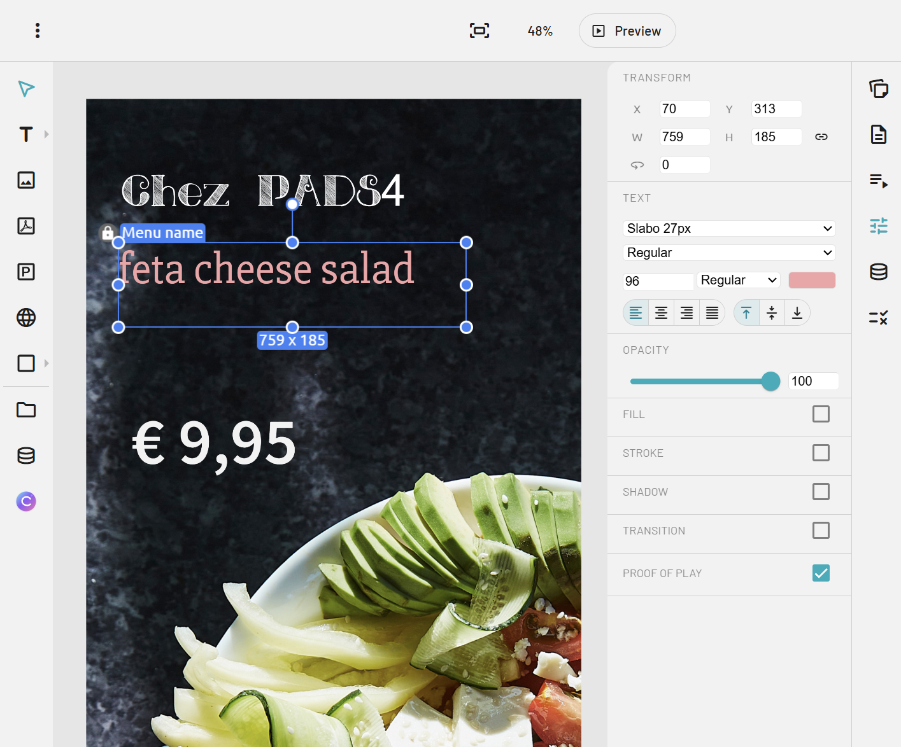

PADS4 Designer is a flexible tool for creating and managing digital signage presentations in the browser. It lets users build content-rich layouts with text, images, videos, web pages, and data-driven elements, so presentations can be simple or highly dynamic. 

A key advantage of the PADS4 Designer is the way it helps teams work efficiently. Designers can focus on layout, while content editors can update information without changing the full design. It also supports data providers, which means you can connect to sources like OData, RSS feeds, and other structured data to show real-time information automatically.

<Frame caption="PADS4 Designer">
  
</Frame>

## Related

- [PADS4 Digital Signage manual](/digital-signage/introduction) 
