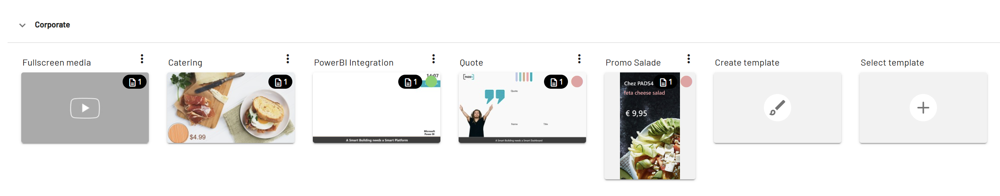

CMS 2.0 est un système de gestion de contenu web pour la signalétique numérique. Vous l'utilisez pour créer, organiser et publier du contenu sur de nombreux écrans.

## Fonctionnement de CMS 2.0

CMS 2.0 sépare la conception du contenu. Les designers créent des modèles, et les éditeurs ajoutent des messages à ces modèles. Comme les tâches sont séparées, les designers et les éditeurs peuvent travailler en même temps.

<Frame caption="Un modèle dans CMS 2.0">
  
</Frame>

## Rôles et permissions

Les administrateurs attribuent des rôles et des permissions pour contrôler qui peut modifier, planifier ou publier des catégories, des modèles et des messages spécifiques.

Vous pouvez également attribuer un modèle à des Viewers spécifiques. Seuls ces Viewers pourront alors utiliser la mise en page, et seuls les utilisateurs disposant des permissions pourront la planifier.

## Planification

Les planifications dans CMS 2.0 utilisent des priorités. Un message avec une priorité plus élevée remplace le contenu normal, de sorte que les messages urgents sont diffusés en premier. Pour chaque écran, vous pouvez voir ce qui est en cours de diffusion et ce qui est planifié.

## Données en direct

CMS 2.0 se connecte à des sources de données telles que les flux OData et RSS. Les informations en direct, par exemple les actualités, la météo ou les cours des actions, apparaissent automatiquement dans vos messages.

## Connexe

* [Manuel PADS4 Digital Signage](/digital-signage/introduction)
