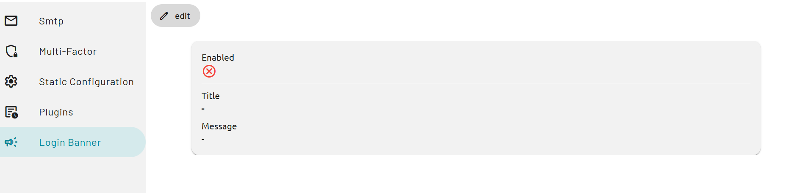
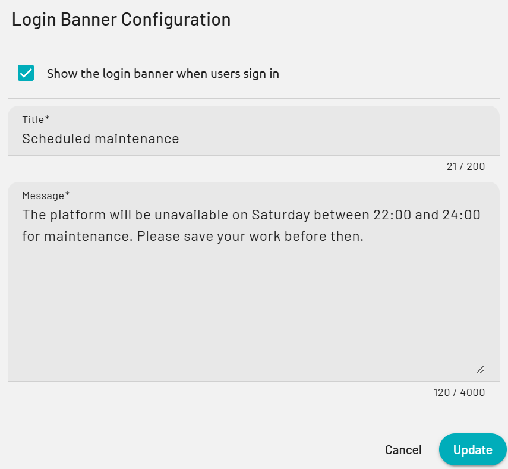
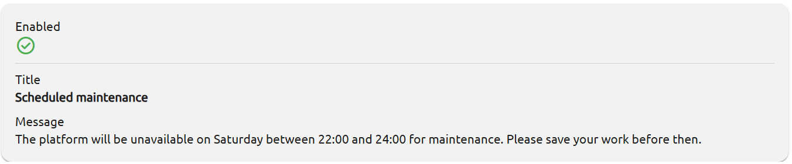

La bannière de connexion affiche un titre et un message aux utilisateurs lorsqu'ils se connectent à PADS4. Utilisez-la pour les annonces que chaque utilisateur doit voir, comme une maintenance planifiée ou un changement de politique. Vous configurez la bannière dans PADS4 CTRL Center.

## Avant de commencer

* Vous devez avoir accès à l'application **Config** dans PADS4 CTRL Center.
* Choisissez le titre (jusqu'à 200 caractères) et le message (jusqu'à 4 000 caractères). Tous les utilisateurs voient la bannière, vérifiez donc le texte avant de l'enregistrer.

## Configurer la bannière de connexion

<Steps>
  <Step title="Ouvrir la page Bannière de connexion">
    Dans PADS4 CTRL Center, ouvrez le menu de l'application et sélectionnez **Config**. Dans la navigation à gauche, sélectionnez **Login Banner**.

    <Frame caption="La page Bannière de connexion avant la configuration de la bannière">
      
    </Frame>
  </Step>

  <Step title="Ouvrir les paramètres">
    Sélectionnez **edit**. La boîte de dialogue **Login Banner Configuration** s'ouvre.

    <Frame caption="La boîte de dialogue Login Banner Configuration">
      
    </Frame>
  </Step>

  <Step title="Saisir le texte de la bannière">
    1. Sélectionnez **Show the login banner when users sign in**.
    2. Dans **Title**, saisissez un titre court. Par exemple : `Scheduled maintenance`.
    3. Dans **Message**, saisissez le texte que les utilisateurs doivent lire. Par exemple : `The platform will be unavailable on Saturday between 22:00 and 24:00 for maintenance. Please save your work before then.`

    Les compteurs sous les champs indiquent le nombre de caractères utilisés.

    <Frame caption="La boîte de dialogue avec l'exemple de bannière">
      
    </Frame>
  </Step>

  <Step title="Enregistrer la bannière">
    Sélectionnez **Update**. PADS4 affiche le message **Changes saved successfully.**
  </Step>
</Steps>

## Modifier ou supprimer la bannière

* Pour modifier le texte, sélectionnez **edit**, modifiez le **Title** ou le **Message**, et sélectionnez **Update**.
* Pour arrêter d'afficher la bannière, sélectionnez **edit**, décochez **Show the login banner when users sign in**, et sélectionnez **Update**. PADS4 conserve le titre et le message.

Pour fermer la boîte de dialogue sans enregistrer, sélectionnez **Cancel**.
