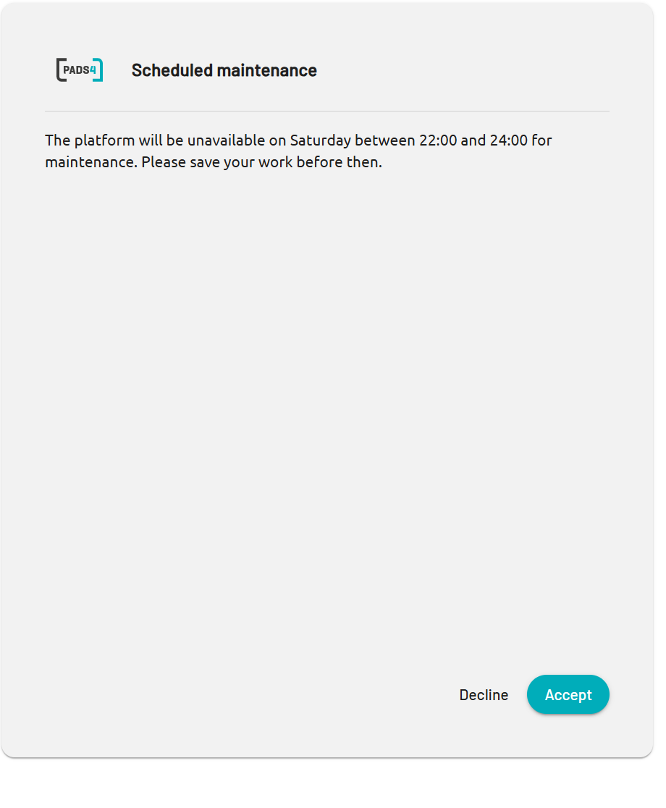

Lorsque vous vous connectez à PADS4, votre administrateur peut vous afficher un message. Ce message est la bannière de connexion. Les administrateurs l'utilisent pour des annonces que tout le monde doit connaître, comme une maintenance planifiée ou un changement de politique.

## Ce que vous voyez

La bannière de connexion comporte un titre et un message. Par exemple :

<table>
  <colgroup>
    <col width="100" />

    <col width="553" />
  </colgroup>

  <thead>
    <tr>
      <th>Partie</th>
      <th>Exemple</th>
    </tr>
  </thead>

  <tbody>
    <tr>
      <td>**Titre**</td>
      <td>Maintenance planifiée</td>
    </tr>

    <tr>
      <td>**Message**</td>
      <td>La plateforme sera indisponible le samedi entre 22h00 et 24h00 pour maintenance. Veuillez enregistrer votre travail avant cette heure.</td>
    </tr>
  </tbody>
</table>

{/* SCREENSHOT: The login banner as a user sees it after signing in to PADS4, with the example title and message. Crop to the banner. */}

<Frame caption="Une bannière de connexion avec un titre et un message">
  
</Frame>

## Lire la bannière

<Steps>
  <Step title="Se connecter à PADS4">
    Saisissez votre nom d'utilisateur et votre mot de passe, puis sélectionnez le bouton fléché.
  </Step>

  <Step title="Lire le titre et le message">
    Lisez la bannière et suivez les instructions du message.
  </Step>

  <Step title="Accepter ou refuser">
    * Pour continuer vers PADS4, sélectionnez **Accepter**.
    * Pour fermer le message et PADS4, sélectionnez **Refuser**.
  </Step>
</Steps>

Vous devez sélectionner **Accepter** pour utiliser PADS4.

## Si vous ne voyez pas de bannière

L'administrateur active et désactive la bannière. Si aucune bannière n'apparaît, aucune annonce n'est active. Si vous attendiez un message, contactez votre administrateur PADS4.
