<Warning>
  Cet article nécessite que vous disposiez au minimum de la version PADS4 2025.2.
</Warning>

Ce document fournit des instructions étape par étape pour créer des identifiants OAuth2 pour l'authentification SMTP à l'aide des plateformes Google et Microsoft. Ce document suppose que le lecteur possède une connaissance de base de Google Cloud Platform.

## **1. Créer un projet Google Cloud**

* Accédez à la Google Cloud Console : [https://console.cloud.google.com/](https://console.cloud.google.com/)
* Cliquez sur le menu déroulant du projet en haut de la page et sélectionnez **'Sélectionner un projet'** puis cliquez sur **'Nouveau projet'.**
  * **Nom du projet** : Entrez un nom descriptif pour votre projet
  * **Emplacement** : Sélectionnez l'emplacement approprié ou laissez la valeur par défaut

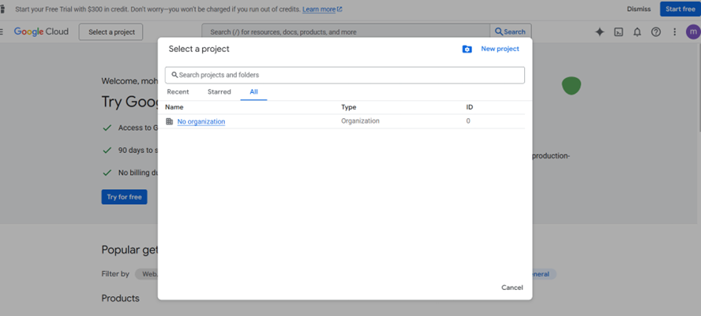

* Cliquez sur **Créer** pour créer votre projet

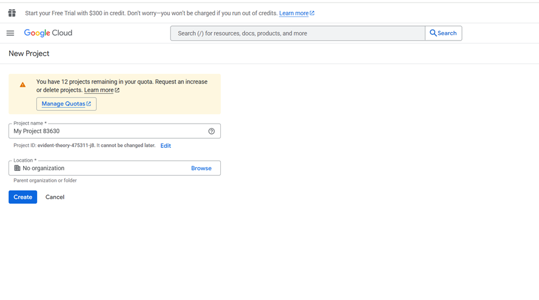

## **2. Activer l'API Gmail**

* Dans votre projet nouvellement créé, accédez à **APIs & Services > Bibliothèque**
* Rechercher "Gmail API" dans la barre de recherche

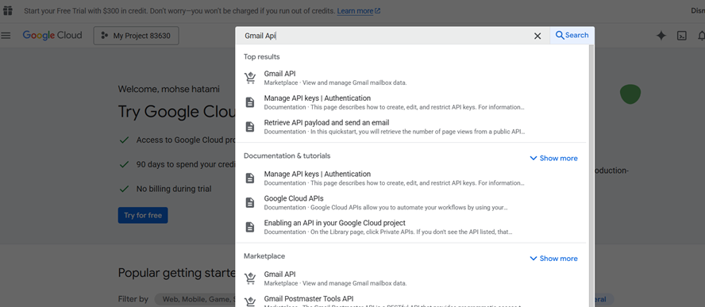

* Cliquer sur **Gmail API** dans les résultats
* Cliquer sur **Enable** pour activer la Gmail API pour votre projet

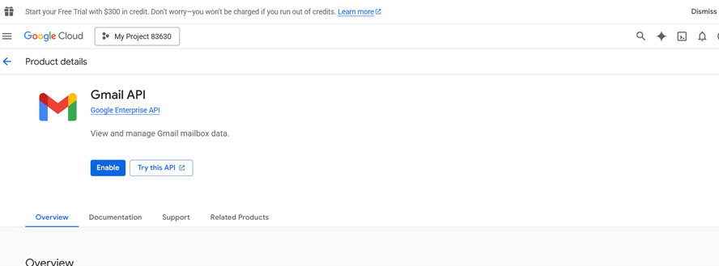

## **3. Configurer l'écran de consentement OAuth**

* Accéder à **APIs & Services > OAuth consent screen**

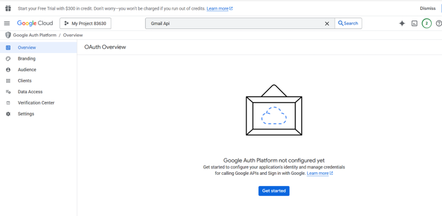

* Cliquer sur **Get started**
* Remplir les informations requises sur l'application
  * Appname: Name of your application e.g. **PADS4**
  * E-mail d'assistance utilisateur : Sélectionner votre adresse e-mail
  * Coordonnées du développeur : Saisir votre adresse e-mail

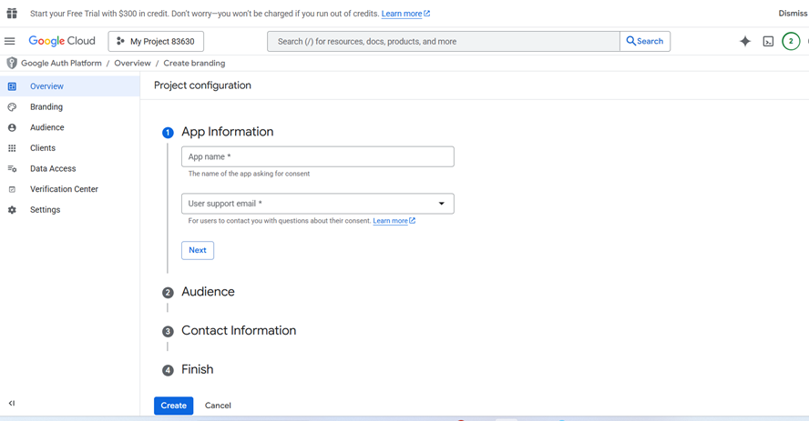

* Sélectionner le type d'utilisateur
  * Internal: For Google Workspace users only (recommended if applicable)
  * External: For any Google account user
* Cliquer sur **Save and continue**

## **4. Créer des identifiants OAuth2**

* Aller à **APIs & Services > Clients**

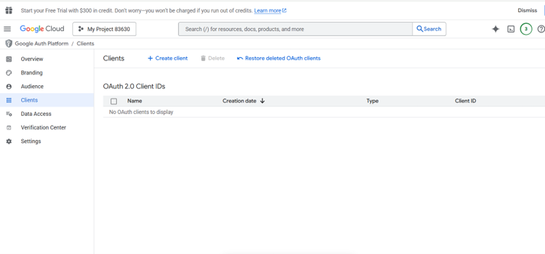

* Cliquer sur **Create client**
* Sélectionner **Web application** comme type d'application (Web application)
* Saisir un nom pour votre client OAuth

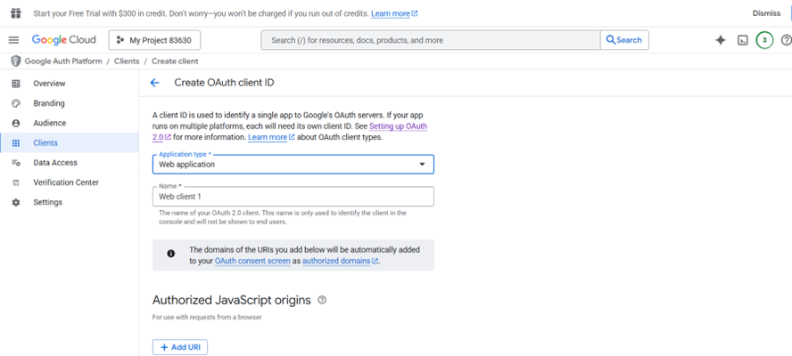

* Sous **Authorized redirect URIs**, cliquer sur **Add URI** et saisir :
  * http\://\<host>:\<port>/credentials/generic/authorize/callback
    * **Host:** Nom DNS ou adresse IP de votre PADS4 Web Portal
    * **Port:** Facultatif, si le PADS4 Web Portal n'utilise pas les ports par défaut pour HTTP ou HTTPS, vous devez spécifier le numéro de port.

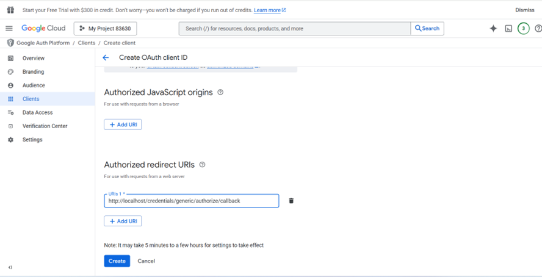

* Cliquer sur **create**
* Une boîte de dialogue apparaîtra avec votre **client ID** et **client secret**. Copiez ou téléchargez ces valeurs et conservez-les en lieu sûr, car vous en aurez besoin pour la configuration de PADS4

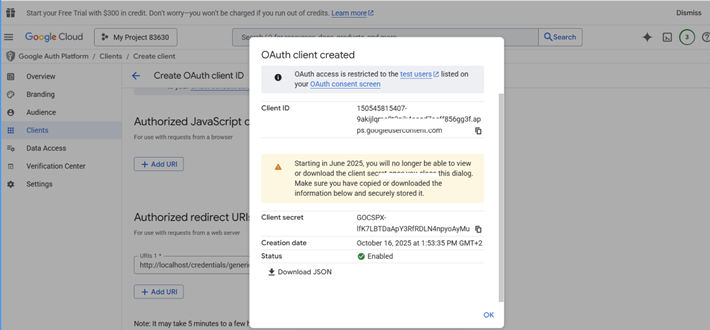

## **5. Configuration dans PADS4**

Pour commencer :

* Ouvrir votre **navigateur web**.
* Accéder à l'**URL du serveur PADS4** (un nom DNS ou une adresse IP).
* Se connecter avec un **compte Administrateur**.

Une fois connecté :

* Cliquer sur **Dashboard**.
* Utiliser le bouton **Toggle Sidebar** situé en **haut à droite** de l'écran.
* Accéder à **Credentials**.
* Puis sélectionner **Providers**.
* Cliquer sur **New**

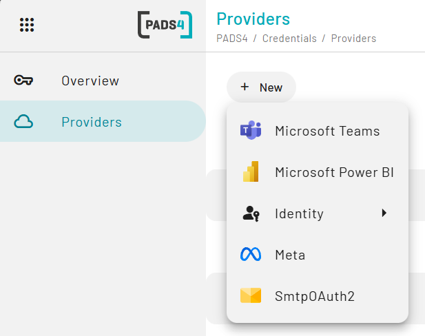

* Sélectionner **SMTPOAuth2**

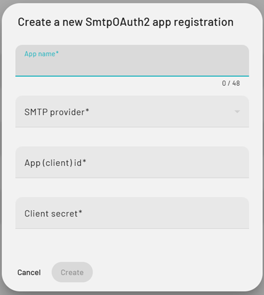

* Remplir les informations comme suit :
  * **Nom de l'application :** Représente le nom de votre fournisseur dans PADS4 (peut être n'importe quelle valeur)
  * **Fournisseur SMTP :** Google
  * **ID d'application (client) :** Récupéré depuis la Google Cloud Console décrite à l'étape 4
  * **Secret client :** Récupéré depuis la Google Cloud Console décrite à l'étape 4
* Cliquer sur **create**
* Accédez maintenant à la page de présentation et sélectionnez le fournisseur SMTP que vous venez de configurer.
* Cliquer sur Connecter, sélectionner votre compte utilisateur et accorder l'accès demandé.

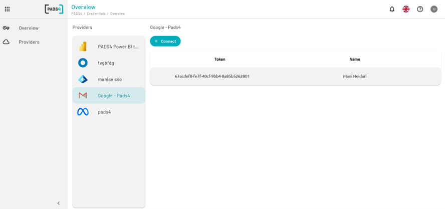

## Comment utiliser cette configuration dans la configuration SMTP.

Une fois connecté :

* Cliquer sur **Home**.
* Utiliser le bouton **Toggle Sidebar** situé en **haut à gauche** de l'écran.
* Accéder à **Config**.
* Puis cliquer sur **Edit**

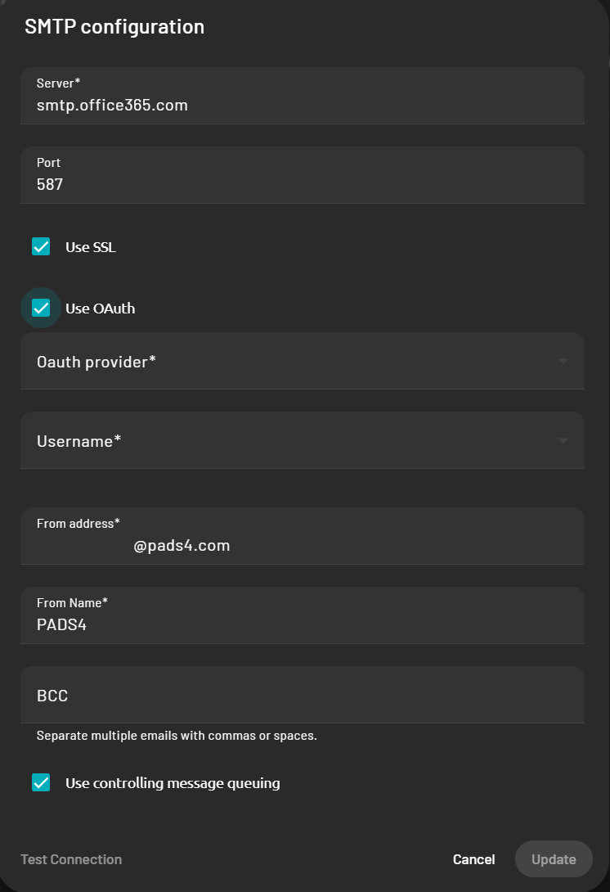
