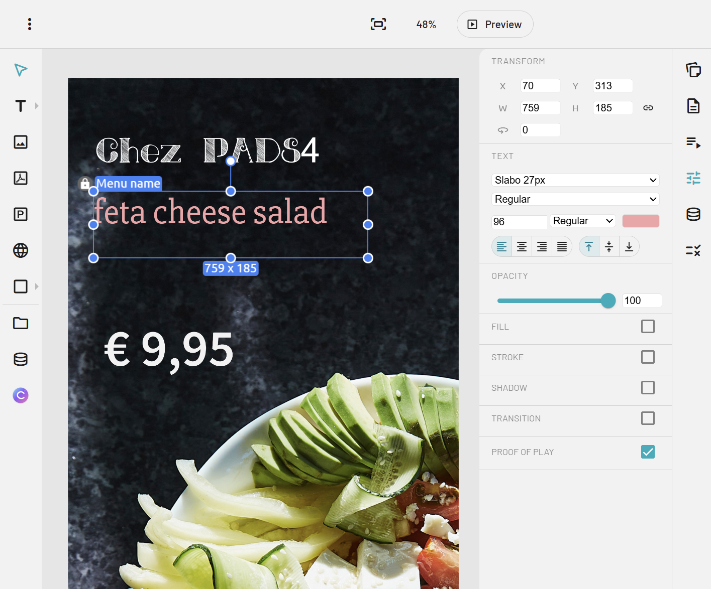

PADS4 Designer est un outil flexible pour créer et gérer des présentations de signalétique numérique dans le navigateur. Il permet aux utilisateurs de créer des mises en page riches en contenu avec du texte, des images, des vidéos, des pages web et des éléments pilotés par les données, de sorte que les présentations peuvent être simples ou très dynamiques.

Un avantage clé de PADS4 Designer est la façon dont il aide les équipes à travailler efficacement. Les designers peuvent se concentrer sur la mise en page, tandis que les éditeurs de contenu peuvent mettre à jour les informations sans modifier la conception complète. Il prend également en charge les fournisseurs de données, ce qui signifie que vous pouvez vous connecter à des sources telles que OData, les flux RSS et d'autres données structurées pour afficher automatiquement des informations en temps réel.

<Frame caption="PADS4 Designer">
  
</Frame>

## Connexe

* [Manuel PADS4 Digital Signage](/digital-signage/introduction)
