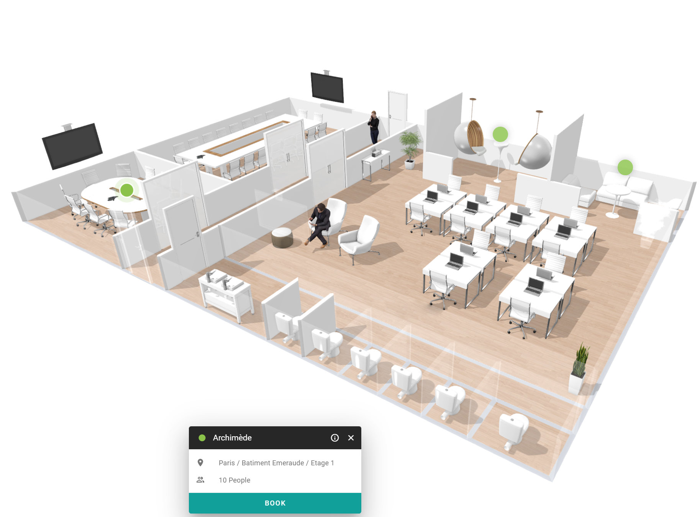

La vue du plan d'étage affiche la disposition d'un étage avec un bouton pour chaque salle. Utilisez-la lorsque vous savez où vous souhaitez vous trouver, par exemple près de votre équipe, et que vous voulez voir quelles salles y sont disponibles.

<Info>
  Un plan d'étage n'est disponible que pour les étages disposant d'une carte d'étage. Les salles sans position sur la carte d'étage n'y apparaissent pas.
</Info>

## Ouvrir le plan d'étage

<Steps>
  <Step title="Ouvrir la vue du plan d'étage">
    Dans l'aperçu des espaces, sélectionnez l'icône du plan d'étage dans le coin supérieur droit de l'écran.
  </Step>

  <Step title="Choisir un bâtiment et un étage">
    Sélectionnez le bâtiment et l'étage que vous souhaitez voir.
  </Step>

  <Step title="Sélectionner une salle">
    Sélectionnez le bouton d'une salle sur le plan d'étage pour en voir les détails. Voir [Afficher les détails d'un espace](/modules/workspace/workspace-web-application/space-details).
  </Step>
</Steps>

{/* SCREENSHOT: PADS4 Workspace, the floor plan view with room buttons on a floor map. */}

Les salles que votre administrateur a définies comme inactives sont temporairement indisponibles.

## Connexe

* [Rechercher un espace](/fr/modules/workspace/workspace-web-application/searching-for-a-space)
* [Filtrer les espaces](/modules/workspace/workspace-web-application/filter-spaces)
* [Réserver un espace](/fr/modules/workspace/workspace-web-application/booking-a-space)
