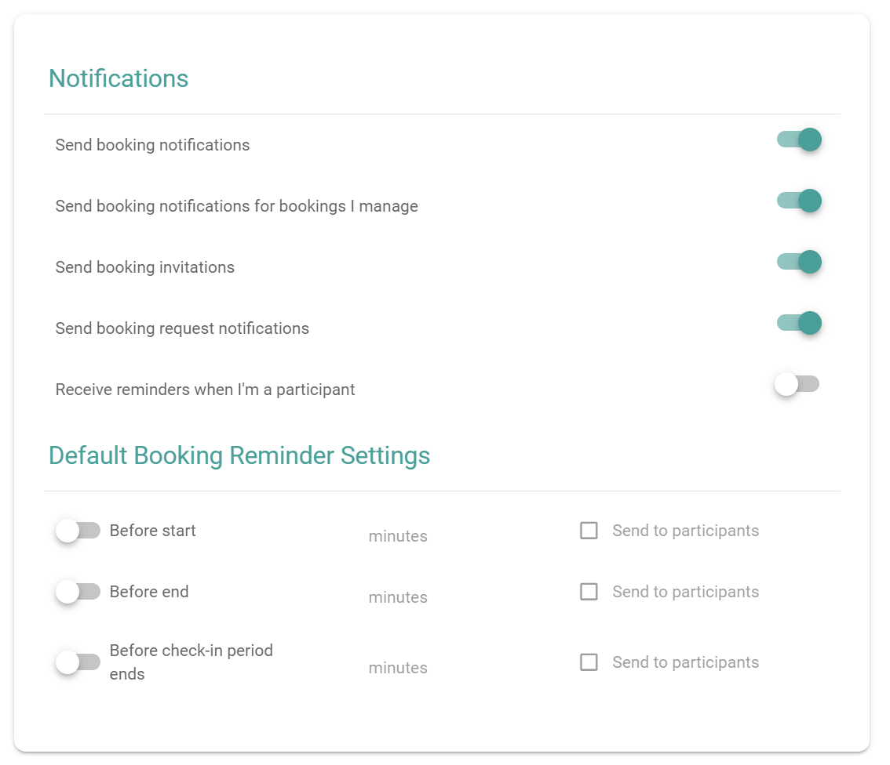

PADS4 Workspace vous informe de vos réservations. Vous choisissez les notifications que vous recevez et vous définissez les rappels par défaut pour vos réservations.

## Avant de commencer

Votre administrateur définit les paramètres de notification par défaut pour tous les utilisateurs.

## Ouvrir les paramètres

Dans le menu principal, sélectionnez **Paramètres**. Les paramètres de notification se trouvent dans la section **Notifications** et les paramètres de rappel se trouvent dans la section **Paramètres de rappel de réservation par défaut**.

<Frame caption="Les sections Notifications et Paramètres de rappel de réservation par défaut">
  
</Frame>

## Choisir vos notifications

Activez ou désactivez chaque interrupteur.

| Paramètre                                                                      | Description                                                                                 |
| ------------------------------------------------------------------------------ | ------------------------------------------------------------------------------------------- |
| **Envoyer des notifications de réservation**                                   | Vous envoie des notifications concernant vos réservations.                                  |
| **Envoyer des notifications de réservation pour les réservations que je gère** | Vous envoie des notifications concernant les réservations dans les salles que vous gérez.   |
| **Envoyer des invitations de réservation**                                     | Envoie des invitations pour vos réservations.                                               |
| **Envoyer des notifications de demande de réservation**                        | Vous envoie des notifications concernant les demandes de réservation.                       |
| **Recevoir des rappels lorsque je suis participant**                           | Vous envoie des rappels pour les réservations où vous êtes participant et non organisateur. |

## Définir les rappels de réservation par défaut

Les rappels par défaut s'appliquent aux réservations que vous effectuez. Pour chaque rappel, définissez quand PADS4 Workspace l'envoie et qui le reçoit.

| Rappel                                          | Envoyé                                                         |
| ----------------------------------------------- | -------------------------------------------------------------- |
| **Avant le début**                              | Avant le début de la réservation.                              |
| **Avant la fin**                                | Avant la fin de la réservation.                                |
| **Avant la fin de la période d'enregistrement** | Avant la fin de la période d'enregistrement de la réservation. |

<Steps>
  <Step title="Activer le rappel">
    Activez l'interrupteur pour le rappel dont vous avez besoin.
  </Step>

  <Step title="Saisir le nombre de minutes">
    Saisissez le nombre de minutes avant l'événement auquel PADS4 Workspace envoie le rappel.
  </Step>

  <Step title="Sélectionner les destinataires">
    (Facultatif) Sélectionnez **Envoyer aux participants** pour envoyer également le rappel aux participants de la réservation.
  </Step>
</Steps>

Vous pouvez également définir des rappels pour une seule réservation. Voir [Définir des rappels pour une réservation](/fr/modules/workspace/booking-reminders).
