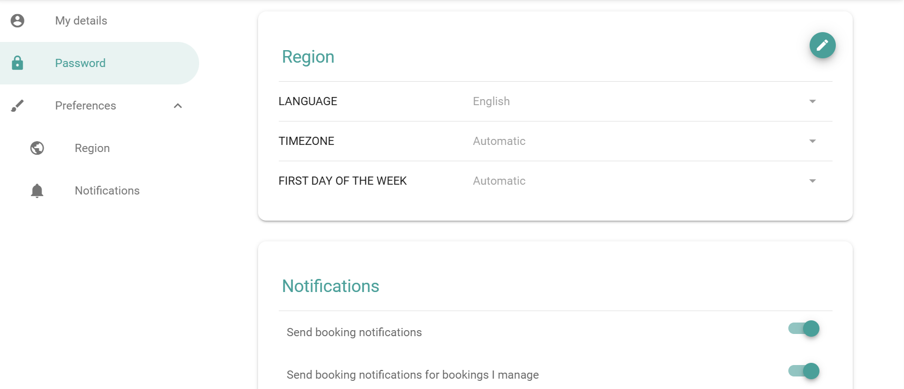

Les paramètres du compte contiennent vos préférences personnelles et vos informations de base pour PADS4 Workspace. Vous pouvez les modifier uniquement pour votre propre compte.

## Ouvrir les paramètres du compte

Dans le menu principal, sélectionnez **Paramètres**.

## Paramètres que vous pouvez consulter ou modifier

<table>
  <colgroup>
    <col width="156" />

    <col width="540" />
  </colgroup>

  <thead>
    <tr>
      <th>Paramètre</th>
      <th>Description</th>
    </tr>
  </thead>

  <tbody>
    <tr>
      <td>**Informations de connexion**</td>
      <td>Indique comment vous vous connectez. Vous ne pouvez pas le modifier si vous vous connectez avec l'authentification unique (SSO).</td>
    </tr>

    <tr>
      <td>**Mot de passe**</td>
      <td>Modifie votre mot de passe. Vous pouvez le modifier uniquement si vous n'utilisez pas le SSO.</td>
    </tr>

    <tr>
      <td>**Langue**</td>
      <td>La langue de l'interface PADS4 Workspace. Sélectionnez la langue que vous préférez.</td>
    </tr>

    <tr>
      <td>**Notifications**</td>
      <td>Active ou désactive les notifications dans l'application et par e-mail. Voir [Notifications et rappels par défaut](/fr/modules/workspace/account-notifications).</td>
    </tr>

    <tr>
      <td>**Rappels**</td>
      <td>Vos paramètres de rappel par défaut. Voir [Notifications et rappels par défaut](/fr/modules/workspace/account-notifications).</td>
    </tr>
  </tbody>
</table>

<Note>
  Si vous vous connectez avec le SSO, les champs **Informations de connexion** et **Mot de passe** sont désactivés pour des raisons de sécurité et de conformité. Votre organisation les gère via son fournisseur d'identité.
</Note>
