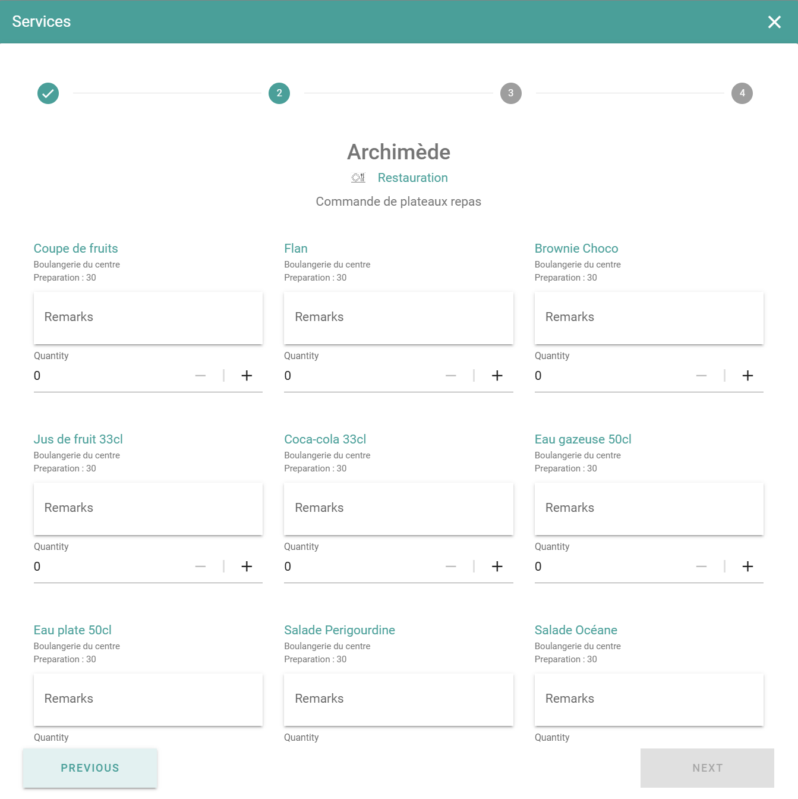

Ajoutez des services à une réservation lorsque la réunion nécessite plus que la salle. Par exemple, la restauration, le support audiovisuel ou l'aménagement de la salle.

## Avant de commencer

Votre administrateur décide quels services existent et pour quelles salles. Si vous ne voyez pas un service, contactez votre administrateur. Voir [Services supplémentaires](/fr/modules/workspace/workspace-admin/additional-services).

## Ajouter un service

<Steps>
  <Step title="Ouvrir les services">
    Dans la fenêtre de réservation, sélectionnez **Ajouter des services supplémentaires**.
  </Step>

  <Step title="Sélectionner les services">
    Sélectionnez les services dont vous avez besoin parmi les options disponibles.
  </Step>

  <Step title="Saisir la quantité et un commentaire">
    Saisissez la quantité pour chaque service. Si le service autorise les commentaires, saisissez un commentaire, par exemple une note alimentaire pour la restauration.
  </Step>

  <Step title="Confirmer les services">
    Sélectionnez **Confirmer** pour associer les services à la réservation.
  </Step>

  <Step title="Enregistrer la réservation">
    Sélectionnez **Enregistrer**.
  </Step>
</Steps>

PADS4 envoie la demande de service à l'adresse e-mail que votre administrateur a définie pour le service.

## Associé

* [Réserver un espace](/fr/modules/workspace/workspace-web-application/booking-a-space)
* [Services supplémentaires](/fr/modules/workspace/workspace-admin/additional-services)
