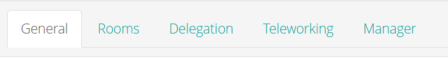
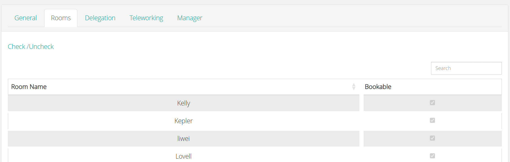
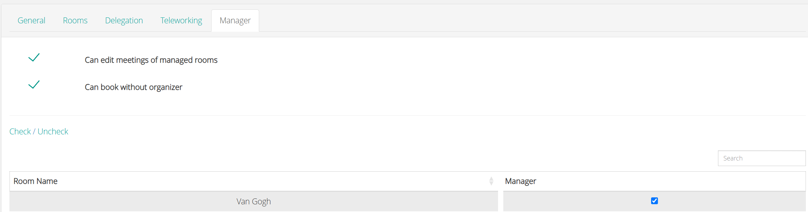

Utilisez cette page pour consulter les paramètres d'un utilisateur de salle. Pour créer un utilisateur, voir [Ajouter un utilisateur de salle](/modules/workspace/workspace-admin/add-a-room-user). Pour ouvrir les paramètres, accédez à **Room Users**, puis ouvrez l'utilisateur.

Un utilisateur de salle possède cinq onglets.

<Frame caption="Les onglets d'un utilisateur de salle">
  
</Frame>

<table>
  <colgroup>
    <col width="141" />

    <col width="593" />
  </colgroup>

  <thead>
    <tr>
      <th>Onglets</th>
      <th>Utilisation</th>
    </tr>
  </thead>

  <tbody>
    <tr>
      <td>**Général**</td>
      <td>Saisir les informations de l'utilisateur et définir les options de réservation.</td>
    </tr>

    <tr>
      <td>**Salles**</td>
      <td>Choisir les salles que l'utilisateur peut consulter et réserver.</td>
    </tr>

    <tr>
      <td>**Délégation**</td>
      <td>Autoriser l'utilisateur à réserver au nom d'un autre utilisateur.</td>
    </tr>

    <tr>
      <td>**Télétravail**</td>
      <td>Définir l'allocation de travail à distance de l'utilisateur.</td>
    </tr>

    <tr>
      <td>**Responsable**</td>
      <td>Accorder à l'utilisateur des droits sur les salles qu'il gère.</td>
    </tr>
  </tbody>
</table>

## Général

<table>
  <colgroup>
    <col width="221" />

    <col width="515" />
  </colgroup>

  <thead>
    <tr>
      <th>Paramètre</th>
      <th>Description</th>
    </tr>
  </thead>

  <tbody>
    <tr>
      <td>**E-mail**</td>
      <td>L'adresse e-mail de l'utilisateur.</td>
    </tr>

    <tr>
      <td>**Nom**</td>
      <td>Le nom de famille de l'utilisateur.</td>
    </tr>

    <tr>
      <td>**Prénom**</td>
      <td>Le prénom de l'utilisateur.</td>
    </tr>

    <tr>
      <td>**Numéro NFC**</td>
      <td>Le numéro de la carte NFC de l'utilisateur. Par exemple, un utilisateur peut utiliser une carte d'accès NFC pour réserver rapidement une salle.</td>
    </tr>

    <tr>
      <td>**Télétravail**</td>
      <td>Sélectionnez cette option si l'utilisateur travaille depuis un site distant.</td>
    </tr>

    <tr>
      <td>**Empêcher la réservation de salle**</td>
      <td>Sélectionnez cette option pour empêcher l'utilisateur de réserver des salles.</td>
    </tr>

    <tr>
      <td>**Demande de réservation activée**</td>
      <td>Sélectionnez cette option pour permettre à l'utilisateur d'envoyer des demandes de réservation à son responsable. Voir [Soumettre une demande de réservation](/fr/modules/workspace/booking-request).</td>
    </tr>

    <tr>
      <td>**Activer l'aperçu des réservations**</td>
      <td>Active l'onglet **Responsable**. L'utilisateur peut alors modifier les réunions dans les salles dont il est responsable.</td>
    </tr>
  </tbody>
</table>

## Salles

Utilisez l'onglet **Salles** pour choisir les salles que l'utilisateur peut utiliser pour réserver. L'onglet affiche la liste des salles. Cochez la case de chaque salle que l'utilisateur peut réserver.

<table>
  <colgroup>
    <col width="153" />

    <col width="564" />
  </colgroup>

  <thead>
    <tr>
      <th>Contrôle</th>
      <th>Description</th>
    </tr>
  </thead>

  <tbody>
    <tr>
      <td>**Case à cocher**</td>
      <td>Cochez la case d'une salle pour autoriser l'utilisateur à la réserver. Décochez-la pour supprimer la salle.</td>
    </tr>

    <tr>
      <td>**Rechercher**</td>
      <td>Recherche une salle dans la liste.</td>
    </tr>

    <tr>
      <td>**Cocher / Décocher**</td>
      <td>Sélectionne ou décoche les cases de toutes les salles en même temps.</td>
    </tr>
  </tbody>
</table>

Sélectionnez **Enregistrer** pour appliquer vos modifications.

## Délégation

Utilisez l'onglet **Délégation** pour autoriser l'utilisateur à effectuer des réservations de salle au nom d'un autre utilisateur. Voir [Réserver au nom d'une autre personne](/fr/modules/workspace/delegation).

## Télétravail

Utilisez l'onglet **Télétravail** pour définir l'allocation de travail à distance de l'utilisateur : le nombre maximum de jours pendant lesquels l'utilisateur peut travailler depuis chez lui ou depuis un autre lieu distant. Vous pouvez également créer des périodes de planification, chacune avec une date de début, une date de fin et le nombre de jours de télétravail autorisés. Voir [Définir l'allocation de travail à distance](/modules/workspace/workspace-admin/remote-work-allowance).

## Responsable

Utilisez l'onglet **Responsable** pour accorder à l'utilisateur des droits sur les salles qu'il gère. L'onglet comporte deux paramètres et une liste de salles.

<Frame caption="L'onglet Responsable d'un utilisateur de salle">
  
</Frame>

<table>
  <colgroup>
    <col width="305" />

    <col width="413" />
  </colgroup>

  <thead>
    <tr>
      <th>Paramètre</th>
      <th>Description</th>
    </tr>
  </thead>

  <tbody>
    <tr>
      <td>**Peut modifier les réunions des salles gérées**</td>
      <td>L'utilisateur peut modifier les réunions dans les salles qu'il gère.</td>
    </tr>

    <tr>
      <td>**Peut réserver sans organisateur**</td>
      <td>L'utilisateur peut réserver une salle sans organisateur. Utilisez cette option lorsque l'organisateur n'est pas connu, ou lorsque l'organisateur n'a pas accès à PADS4 Workspace. Lorsque l'utilisateur réserve une salle, l'organisateur de la réservation est affiché comme **Aucun organisateur**.</td>
    </tr>
  </tbody>
</table>

La liste affiche les salles et une case à cocher Responsable pour chaque salle. Cochez la case pour chaque salle que l'utilisateur gère.

<table>
  <colgroup>
    <col width="161" />

    <col width="546" />
  </colgroup>

  <thead>
    <tr>
      <th>Contrôle</th>
      <th>Description</th>
    </tr>
  </thead>

  <tbody>
    <tr>
      <td>**Cocher / Décocher**</td>
      <td>Sélectionne ou décoche la case **Responsable**.</td>
    </tr>

    <tr>
      <td>**Rechercher**</td>
      <td>Filtre la liste par nom de salle.</td>
    </tr>

    <tr>
      <td>**Nom de la salle**</td>
      <td>Le nom de la salle.</td>
    </tr>

    <tr>
      <td>**Responsable**</td>
      <td>Cochez cette case pour désigner l'utilisateur comme responsable de la salle.</td>
    </tr>

    <tr>
      <td>**Précédent** et **Suivant**</td>
      <td>Permet de naviguer entre les pages lorsque la liste contient plusieurs salles.</td>
    </tr>
  </tbody>
</table>

Sélectionnez **Enregistrer** pour appliquer vos modifications, ou **Annuler** pour fermer l'onglet sans enregistrer les modifications.

Pour les étapes permettant d'accorder des droits de responsable à un utilisateur, voir [Configurer les approbations et les demandes de réservation](/modules/workspace/workspace-admin/booking-approval-setup).
