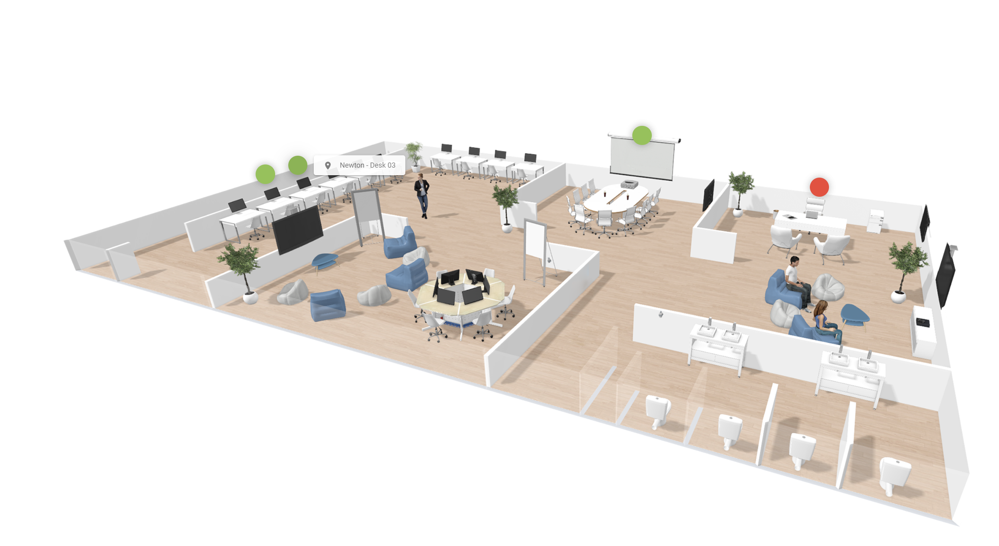

Un espace de travail de groupe est un ensemble de bureaux partagés proches les uns des autres. Utilisez-le lorsqu'un département ou une équipe de projet souhaite travailler ensemble.

## Avant de commencer

Vous devez disposer de droits d'accès à au moins un bureau partagé. Votre administrateur définit ces droits. Voir [Profil utilisateur de salle](/fr/modules/workspace/workspace-admin/room-user-profile).

## Réserver un espace de travail de groupe

<Steps>
  <Step title="Ouvrir l'outil de réservation de groupe">
    Dans votre calendrier, sélectionnez l'icône verte dans le coin inférieur droit de l'écran.
  </Step>

  <Step title="Démarrer la réservation">
    Dans le menu suivant, sélectionnez **Espace**.
  </Step>

  <Step title="Ajouter les participants">
    Ajoutez les personnes pour lesquelles vous réservez des bureaux.
  </Step>

  <Step title="Sélectionner les bureaux">
    Sur le plan interactif à droite, sélectionnez les bureaux souhaités. Choisissez des bureaux proches les uns des autres. Un bureau sélectionné change de couleur.
  </Step>

  <Step title="Enregistrer la réservation">
    Vérifiez que les bureaux apparaissent dans votre liste de réservations, puis sélectionnez **Enregistrer**.
  </Step>
</Steps>

<Check>
  La réservation de groupe apparaît en vert dans votre calendrier.
</Check>

## Connexe

* [Réserver un espace](/fr/modules/workspace/workspace-web-application/booking-a-space)
* [Trouver un espace sur le plan](/fr/modules/workspace/Find-a-space-on-the-floor-plan)
* [Mon calendrier](/fr/modules/workspace/workspace-web-application/my-calendar)
