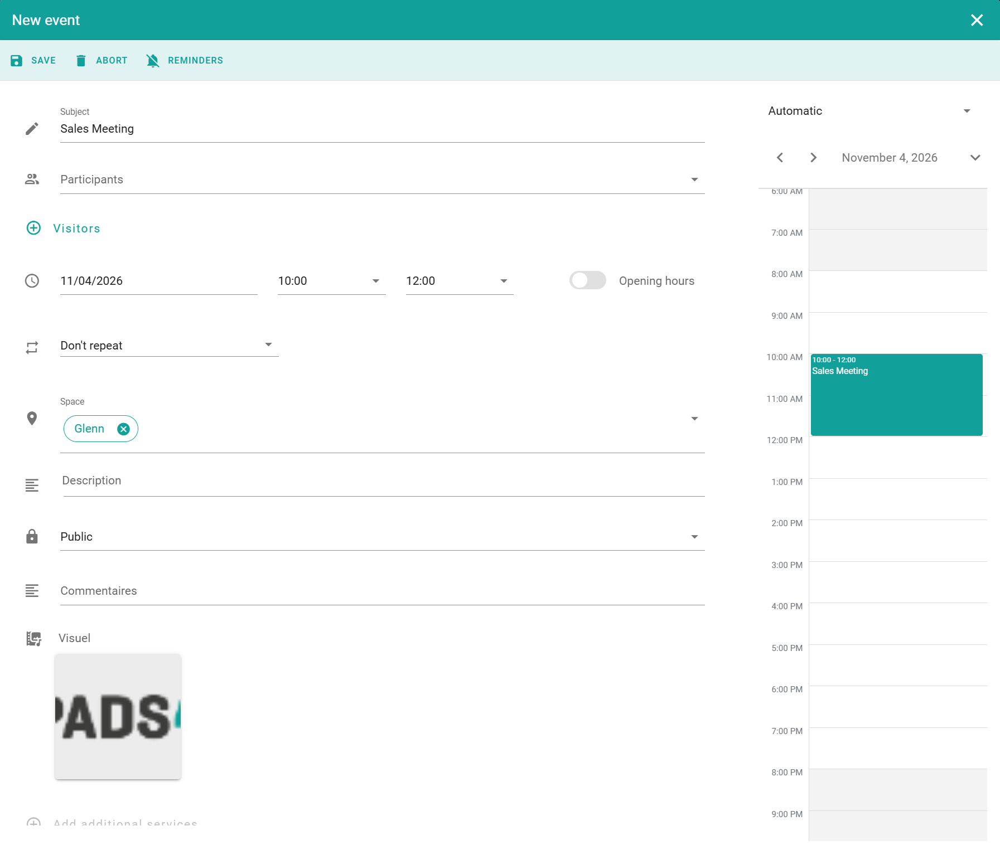

Réservez une salle ou un bureau quand vous en avez besoin pour une réunion, une tâche ou une journée de travail. Après l'enregistrement, la réservation apparaît dans votre calendrier et tous les participants reçoivent une invitation par e-mail.

## Avant de commencer

* Trouvez l'espace que vous souhaitez réserver. Voir [Rechercher un espace](/fr/modules/workspace/workspace-web-application/searching-for-a-space).
* Pour un espace partagé tel qu'une cafétéria, voir [Réserver un espace commun](/fr/modules/workspace/workspace-web-application/booking-a-common-space). Pour des bureaux destinés à une équipe, voir [Réserver un espace de travail de groupe](/fr/modules/workspace/workspace-web-application/booking-a-group-workspace).

## Réserver un espace

<Steps>
  <Step title="Démarrer la réservation">
    Sélectionnez l'espace, puis sélectionnez le bouton **+** en bas à droite de l'écran. La fenêtre de réservation s'ouvre.
  </Step>

  <Step title="Saisir les détails de la réservation">
    Remplissez les champs dont vous avez besoin. Voir [Champs de réservation](#booking-fields).
  </Step>

  <Step title="Ajouter des options">
    (Facultatif) Ajoutez des [participants et visiteurs](/fr/modules/workspace/invite-participants-visitors), [rappels](/fr/modules/workspace/booking-reminders) ou des [services supplémentaires](/fr/modules/workspace/add-service).
  </Step>

  <Step title="Enregistrer la réservation">
    Sélectionnez **Enregistrer**.
  </Step>
</Steps>

<Check>
  La réservation apparaît dans votre calendrier. Voir [Mon calendrier](/fr/modules/workspace/workspace-web-application/my-calendar).
</Check>

<Info>
  Certaines salles nécessitent une approbation. Dans ce cas, la réservation reste *en attente* dans votre calendrier jusqu'à ce qu'un approbateur la confirme. Voir [Workflows](/fr/modules/workspace/workspace-web-application/Workflows).
</Info>

## Champs de réservation

| Champ                        | Description                                                                                                                                                 |
| ---------------------------- | ----------------------------------------------------------------------------------------------------------------------------------------------------------- |
| **Objet**                    | Le titre de la réunion ou de la réservation.                                                                                                                |
| **Participants**             | Les personnes de votre organisation que vous invitez. Voir [Inviter des participants et des visiteurs](/fr/modules/workspace/invite-participants-visitors). |
| **Visiteurs externes**       | Invités extérieurs à votre organisation. Voir [Inviter des participants et des visiteurs](/fr/modules/workspace/invite-participants-visitors).              |
| **Date**                     | La date et l'heure de la réservation.                                                                                                                       |
| **Espace**                   | La salle ou le bureau que vous réservez.                                                                                                                    |
| **Teams Meeting**            | Crée un lien de réunion Microsoft Teams pour la réservation (facultatif).                                                                                   |
| **Description**              | Plus de détails sur la réunion.                                                                                                                             |
| **Public ou Privé**          | Si vous sélectionnez **Privé**, le nom de l'organisateur et l'objet sont masqués sur les affichages des salles et dans les listes publiques.                |
| **Commentaires**             | Notes ou instructions pour la réservation (facultatif).                                                                                                     |
| **Visuel**                   | Une image pouvant apparaître sur les panneaux de salle ou sur l'affichage numérique.                                                                        |
| **Services supplémentaires** | Services supplémentaires, tels que la restauration ou l'équipement. Voir [Ajouter des services à une réservation](/fr/modules/workspace/add-service).       |

<Note>
  Votre administrateur peut activer les réunions Teams pour toutes les réservations par défaut. Cela fonctionne uniquement pour les salles connectées à Exchange.
</Note>
