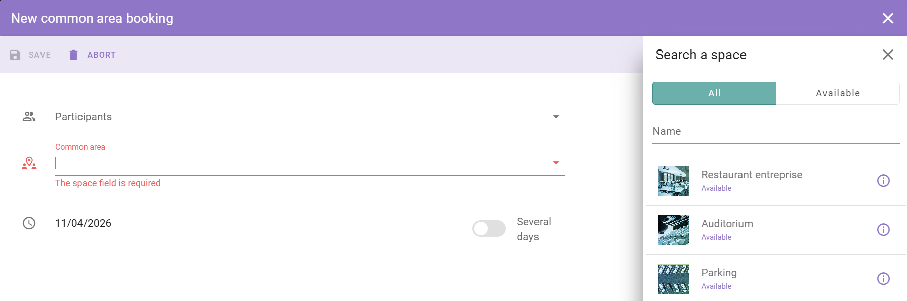

Les espaces communs sont des zones partagées dans votre bâtiment. Par exemple, une cafétéria d'entreprise, une salle de sport, un salon ou une zone de collaboration. Vous réservez une place dans la zone, par exemple un créneau déjeuner ou une séance de sport.

## Réserver un espace commun

<Steps>
  <Step title="Ouvrir votre calendrier">
    Dans le menu principal, sélectionnez **Calendar**.
  </Step>

  <Step title="Ouvrir vos réservations">
    Sélectionnez **My Reservations** pour voir vos réservations actuelles et passées.
  </Step>

  <Step title="Démarrer une nouvelle réservation">
    Sélectionnez le bouton **+** en bas à droite de l'écran.
  </Step>

  <Step title="Choisir le type d'espace commun">
    Sélectionnez l'icône violette pour les espaces communs, puis sélectionnez **Common Space** dans la liste des types d'espaces.
  </Step>

  <Step title="Sélectionner l'espace et l'option">
    Dans le panneau de droite, sélectionnez l'espace commun, par exemple la cafétéria. Sélectionnez ensuite l'option pour cet espace, par exemple un créneau déjeuner ou une séance de sport.
  </Step>

  <Step title="Enregistrer la réservation">
    Sélectionnez **Save**.
  </Step>
</Steps>

<Check>
  La réservation apparaît dans votre calendrier.
</Check>

## Associé

* [Réserver un espace](/fr/modules/workspace/workspace-web-application/booking-a-space)
* [Zone commune](/fr/modules/workspace/workspace-admin/common-area)
* [Mon calendrier](/fr/modules/workspace/workspace-web-application/my-calendar)
