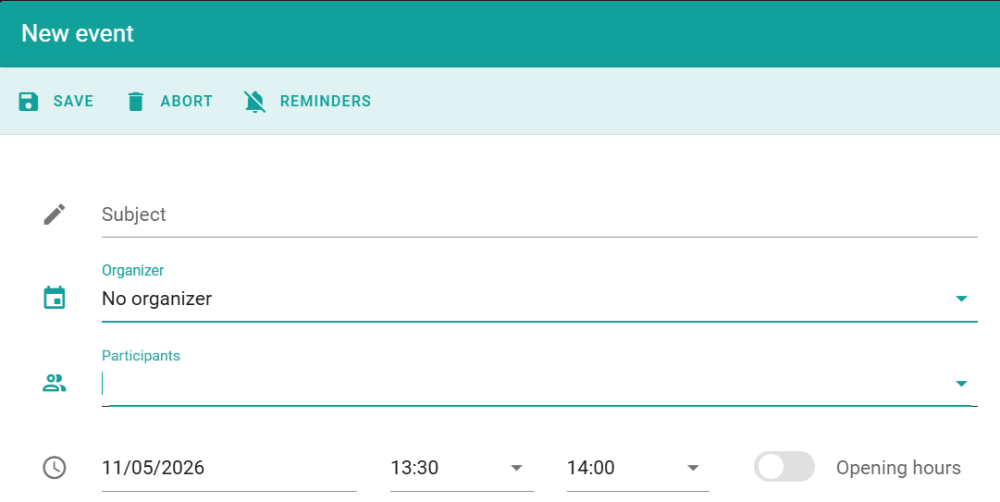

Utilisez une réservation lorsque vous réservez une salle pour quelqu'un, et que l'organisateur de la réunion est inconnu, ou que l'organisateur n'a pas de compte PADS4 Workspace. Vous effectuez la réservation de la même manière que les autres réservations, mais vous sélectionnez **Aucun organisateur**.

## Réserver une salle sans organisateur

<Steps>
  <Step title="Ouvrir la vue d'ensemble">
    Dans PADS4 Workspace, accédez à **Calendrier**, puis sélectionnez **Vue d'ensemble**.
  </Step>

  <Step title="Démarrer la réservation">
    Démarrez une nouvelle réservation de la même manière que vous réservez une salle. Voir [Réserver un espace](/modules/workspace/booking-a-space).
  </Step>

  <Step title="Sélectionner Aucun organisateur">
    Dans le champ organisateur, sélectionnez **Aucun organisateur**.
  </Step>

  <Step title="Saisir les détails">
    Sélectionnez la salle et l'horaire, et saisissez les autres détails de la réservation. Vous pouvez ajouter des participants.
  </Step>

  <Step title="Enregistrer la réservation">
    Sélectionnez **Enregistrer**.
  </Step>
</Steps>

<Check>
  La réservation apparaît dans le calendrier. L'organisateur de la réservation est affiché comme **Aucun organisateur**.
</Check>

## Associé

* [Paramètres utilisateur de la salle](/modules/workspace/workspace-admin/room-user-settings)
* [Réserver un espace](/modules/workspace/booking-a-space)
* [Options de réservation avancées](/fr/modules/workspace/advanced-booking)
