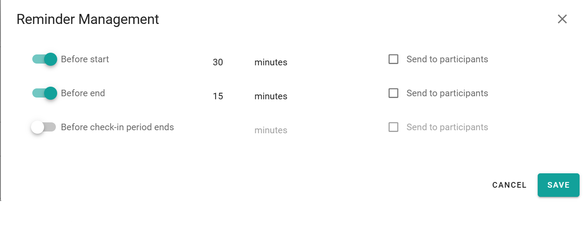

Les rappels vous informent, et éventuellement les participants, du début ou de la fin d'une réservation, ou du moment où il est temps de s'enregistrer. Définissez-les dans la fenêtre de réservation.

## Types de rappels

| Rappel             | Envoyé                            |
| ------------------ | --------------------------------- |
| **Début**          | Avant le début de la réservation. |
| **Fin**            | Avant la fin de la réservation.   |
| **Enregistrement** | Avant l'heure d'enregistrement.   |

## Définir un rappel

<Steps>
  <Step title="Ouvrir les rappels">
    Dans la fenêtre de réservation, sélectionnez **Rappels**.
  </Step>

  <Step title="Activer un rappel">
    Activez le rappel dont vous avez besoin.
  </Step>

  <Step title="Définir l'heure">
    Entrez le nombre de minutes avant l'événement auxquelles le rappel est envoyé.
  </Step>

  <Step title="Choisir les destinataires">
    Choisissez si les participants reçoivent également le rappel.
  </Step>

  <Step title="Enregistrer la réservation">
    Sélectionnez **Enregistrer**.
  </Step>
</Steps>

<Note>
  Votre administrateur définit les paramètres de notification par défaut pour toutes les réservations. Vos rappels remplacent ces paramètres par défaut pour cette réservation.
</Note>

## Associé

* [Réserver un espace](/fr/modules/workspace/workspace-web-application/booking-a-space)
* [Paramètres de l'application Workspace](/fr/Workspace/Administrator/Workspace-Application-Setting)
