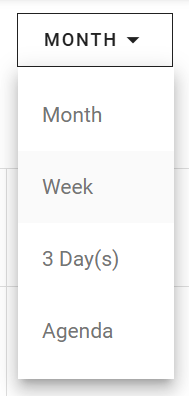

Mon calendrier dispose de quatre vues. Utilisez une vue plus large pour planifier à l'avance, et une vue plus petite pour voir les détails des jours proches.

## Changer de vue

En haut de l'écran, utilisez le sélecteur de vue pour sélectionner une vue.

## Vues disponibles

| Vue                  | Utilisation                                                                                |
| -------------------- | ------------------------------------------------------------------------------------------ |
| **Vue mensuelle**    | Voir tout votre mois en une seule fois.                                                    |
| **Vue hebdomadaire** | Planifier en détail. Elle affiche votre emploi du temps pour une semaine complète.         |
| **Vue sur 3 jours**  | Planifier à court terme. Elle affiche trois jours consécutifs.                             |
| **Vue agenda**       | Voir vos activités à venir dans une liste, par ordre chronologique, pour un aperçu rapide. |

## Connexe

* [Mon calendrier](/modules/workspace/my-calendar)
* [Entrées et couleurs du calendrier](/fr/modules/workspace/calendar-entries)
