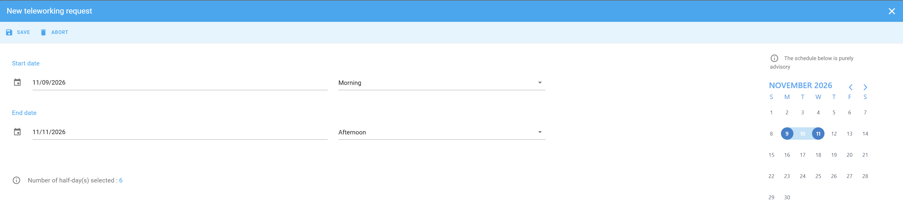
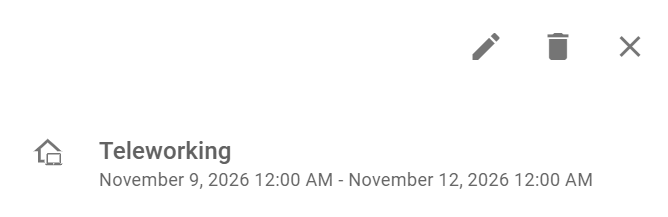

Déclarez les jours où vous travaillez à distance, afin que votre calendrier indique où vous travaillez. PADS4 Workspace déduit ces jours de votre quota annuel.

## Avant de commencer

Votre administrateur doit activer le travail à distance et peut vous attribuer un quota de jours de travail à distance par an. Voir [Travail à distance dans PADS4 Workspace](/modules/workspace/workspace-web-application/remote-work-overview).

## Déclarer le travail à distance

<Steps>
  <Step title="Ouvrir l'outil de travail à distance">
    Dans votre calendrier, sélectionnez l'icône bleue dans le coin inférieur droit de l'écran.
  </Step>

  <Step title="Sélectionner les jours de travail à distance">
    Sélectionnez la date ou la plage de jours pendant lesquels vous travaillez à distance. L'écran affiche le nombre de demi-journées que vous avez sélectionnées. En bas à gauche, vous voyez combien de jours de travail à distance il vous reste cette année.
  </Step>

  <Step title="Enregistrer la déclaration">
    Sélectionnez **Enregistrer**.
  </Step>
</Steps>

<Check>
  La déclaration apparaît en bleu dans votre calendrier, pour la période que vous avez sélectionnée.
</Check>

<Note>
  Si vous sélectionnez plus de jours que votre quota restant, PADS4 Workspace affiche un avertissement indiquant que votre demande dépasse votre quota. \[TODO: confirmer si vous pouvez toujours enregistrer la déclaration après l'avertissement]
</Note>

## Modifier ou supprimer une déclaration de travail à distance

Si vos plans changent, vous pouvez modifier les jours d'une déclaration ou supprimer la déclaration.

<Steps>
  <Step title="Ouvrir la déclaration">
    Dans votre calendrier, sélectionnez l'entrée bleue **Télétravail**. \[TODO: confirmer comment ouvrir l'entrée] Les détails de la déclaration affichent la période.
  </Step>

  <Step title="Modifier ou supprimer la déclaration">
    * Pour modifier les jours, sélectionnez l'icône crayon, modifiez les dates, puis enregistrez vos modifications.
    * Pour supprimer la déclaration, sélectionnez l'icône corbeille.
  </Step>
</Steps>

## Associé

* [Travail à distance dans PADS4 Workspace](/modules/workspace/workspace-web-application/remote-work-overview)
* [Mon calendrier](/fr/modules/workspace/workspace-web-application/my-calendar)
* [Déclarer une absence](/fr/modules/workspace/workspace-web-application/reporting-absence)
