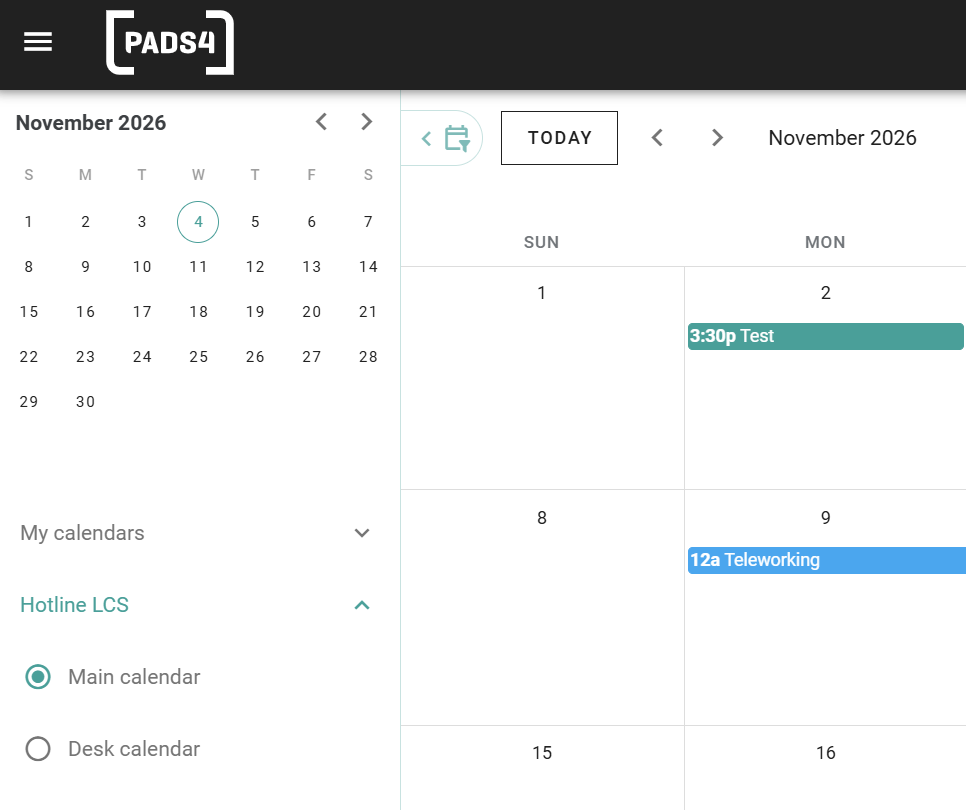

Avec *délégation*, un utilisateur peut gérer les réservations d'un autre utilisateur. Cela est utile pour les assistants de direction qui gèrent un calendrier, ou pour les chefs d'équipe qui réservent pour une équipe.

## Fonctionnement de la délégation

Un administrateur vous donne accès au calendrier d'un autre utilisateur. Le nom de cet utilisateur apparaît alors dans la liste des calendriers sur le côté gauche de PADS4 Workspace. Lorsque vous sélectionnez le calendrier, vous pouvez le consulter et effectuer des réservations via celui-ci.

## Avant de commencer

La délégation est configurée par un administrateur. Dans l'interface d'administration, accédez à **Room Users**, ouvrez l'utilisateur et utilisez la section **Delegation** pour autoriser un autre utilisateur à réserver au nom de cet utilisateur. Voir [Users](/fr/modules/workspace/workspace-admin/users).

## Réserver au nom d'un autre utilisateur

<Steps>
  <Step title="Ouvrir la liste des calendriers">
    Dans PADS4 Workspace, accédez à votre calendrier. Sur la gauche, sous l'aperçu mensuel, vous voyez **My calendars** et le nom de chaque utilisateur pour lequel vous pouvez réserver.
  </Step>

  <Step title="Sélectionner le calendrier de l'utilisateur">
    Développez le nom de l'utilisateur, puis sélectionnez **Main calendar**. Le calendrier affiche les réservations et le travail à distance de cet utilisateur.
  </Step>

  <Step title="Effectuer la réservation">
    Réservez un espace de la manière habituelle. La réservation est effectuée pour l'utilisateur dont vous avez sélectionné le calendrier. Voir [Book a space](/modules/workspace/booking-a-space).
  </Step>
</Steps>

<Frame caption="Les calendriers d'un délégué.">
  
</Frame>

Sous le nom de l'utilisateur, vous pouvez choisir entre deux calendriers :

| Calendrier        | Affiche                                                                                                  |
| ----------------- | -------------------------------------------------------------------------------------------------------- |
| **Main calendar** | Les réservations et les déclarations de l'utilisateur, telles que les réunions et le travail à distance. |
| **Desk calendar** | Le calendrier du bureau de l'utilisateur.                                                                |

Utilisez le filtre **Location** sous les calendriers pour limiter ce que vous voyez à un seul emplacement.

<Check>
  La réservation apparaît dans le calendrier de l'utilisateur pour lequel vous avez réservé.
</Check>
