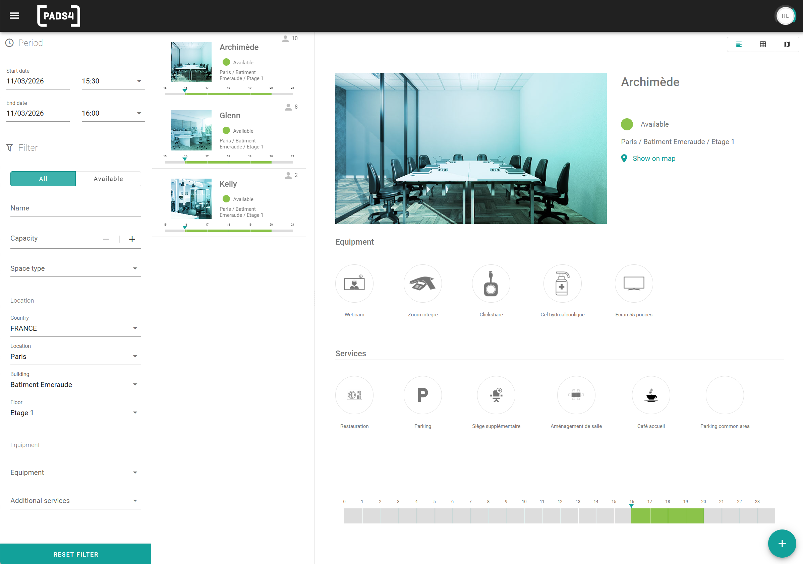

Le moteur de recherche affiche uniquement les espaces qui correspondent à vos critères. Utilisez-le lorsque la liste des espaces est longue, ou lorsqu'une réservation a des exigences spécifiques, telles qu'une capacité minimale ou un projecteur.

## Filtres disponibles

| Filtre                    | Utiliser pour trouver des espaces                                                    |
| ------------------------- | ------------------------------------------------------------------------------------ |
| **Nom**                   | Avec un nom spécifique, ou une partie d'un nom.                                      |
| **Capacité**              | Qui conviennent à un certain nombre de personnes.                                    |
| **Type d'espace**         | D'un type spécifique, par exemple une salle ou un bureau.                            |
| **Pays**                  | Dans un pays.                                                                        |
| **Ville**                 | Dans une ville.                                                                      |
| **Bâtiment**              | Dans un bâtiment.                                                                    |
| **Étage**                 | À un étage.                                                                          |
| **Équipement disponible** | Avec un équipement spécifique, par exemple un projecteur ou un écran.                |
| **Services disponibles**  | Qui proposent des services supplémentaires spécifiques, par exemple la restauration. |

Les filtres de localisation suivent la structure de localisation créée par votre administrateur : pays, ville, bâtiment et étage. Votre administrateur décide également des équipements et services disponibles.

## Filtrer la liste des espaces

<Steps>
  <Step title="Ouvrir le moteur de recherche">
    Dans l'aperçu des espaces, accédez au moteur de recherche.
  </Step>

  <Step title="Définir les filtres">
    Saisissez ou sélectionnez une valeur pour chaque filtre que vous souhaitez utiliser. Vous pouvez combiner des filtres.
  </Step>

  <Step title="Ouvrir un espace">
    Sélectionnez un espace dans les résultats pour voir ses détails. Voir [Voir les détails de l'espace](/fr/modules/workspace/view-space-details).
  </Step>
</Steps>
