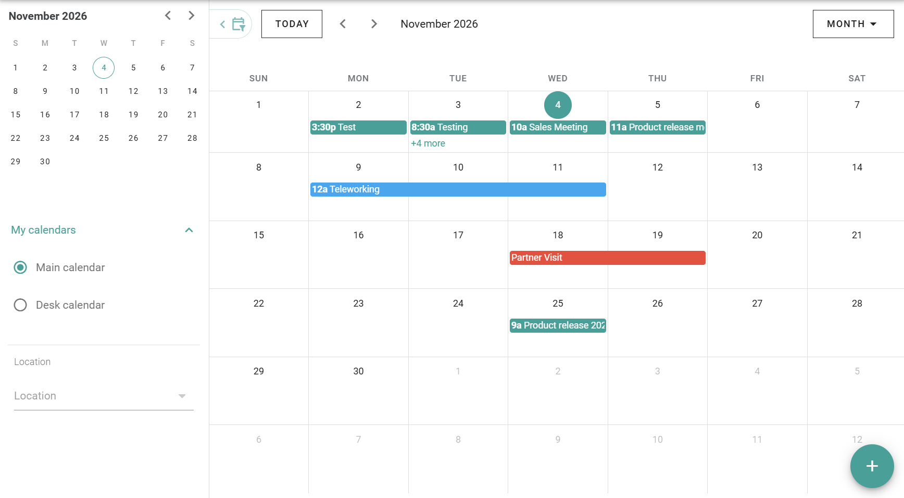

Mon calendrier affiche tout ce que vous avez planifié dans PADS4 Workspace. Vous pouvez également y démarrer de nouvelles réservations et déclarations.

## Ce que Mon calendrier affiche

| Entrée                                      | Voir aussi                                                                              |
| ------------------------------------------- | --------------------------------------------------------------------------------------- |
| Réservations de salles                      | [Réserver un espace](/modules/workspace/booking-a-space)                                |
| Réservations d'espaces communs              | [Réserver un espace commun](/modules/workspace/booking-a-common-space)                  |
| Réservations d'espaces de travail de groupe | [Réserver un espace de travail de groupe](/modules/workspace/booking-a-group-workspace) |
| Déclarations de télétravail                 | [Déclarer le télétravail](/fr/modules/workspace/declaring-remote-work)                  |
| Périodes d'absence                          | [Signaler une absence](/modules/workspace/reporting-absence)                            |

Si un bureau ou une salle vous est attribué(e), vous voyez également son calendrier. Voir [Absence dans PADS4 Workspace](/fr/modules/workspace/absence-overview).

## Naviguer **dans** votre calendrier

Faites défiler pour naviguer dans les mois, les semaines ou les jours. Pour modifier la quantité de votre calendrier affichée, sélectionnez une vue. Voir [Vues du calendrier](/modules/workspace/calendar-views).

## Démarrer une réservation ou une déclaration

Utilisez le bouton **+** en bas à droite de l'écran pour démarrer une action, telle qu'une réservation, une déclaration de télétravail ou une absence. Les icônes et les couleurs pour chaque type sont dans [Entrées et couleurs du calendrier](/fr/modules/workspace/calendar-entries).

## Ouvrir, modifier ou supprimer une entrée

Sélectionnez une entrée pour en voir les détails. Pour le télétravail et les absences, les détails affichent la période ainsi que les icônes pour modifier, supprimer et fermer.

## Associé

* [Vues du calendrier](/modules/workspace/calendar-views)
* [Entrées et couleurs du calendrier](/fr/modules/workspace/calendar-entries)
