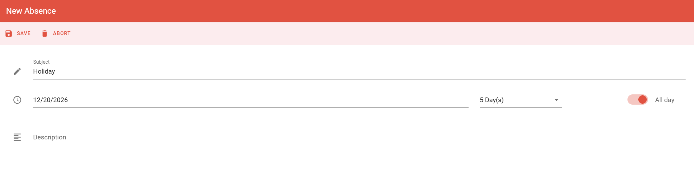
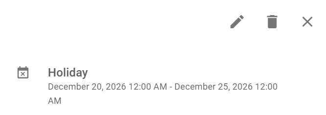

Signalez votre absence pour libérer votre bureau ou bureau attribué pendant les jours où vous êtes absent. D'autres personnes peuvent alors réserver l'espace.

## Avant de commencer

Vous avez besoin d'un bureau ou d'un bureau qui vous est attribué. Si vous en avez un, son calendrier apparaît à côté de votre propre calendrier. Voir [Absence dans PADS4 Workspace](/fr/modules/workspace/absence-overview).

## Signaler une absence

<Steps>
  <Step title="Ouvrez votre calendrier">
    Dans PADS4 Workspace, accédez à votre calendrier. Si vous avez un espace attribué, vous voyez également son calendrier. Cela indique quand vous êtes présent ou absent.
  </Step>

  <Step title="Ouvrez l'outil d'absence">
    Sélectionnez le **+** bouton dans le coin inférieur droit de l'écran, puis sélectionnez l'icône rouge.
  </Step>

  <Step title="Sélectionnez la période d'absence">
    Dans le calendrier, sélectionnez la date de début et la date de fin de votre absence. Vous pouvez sélectionner plusieurs jours à la fois.
  </Step>

  <Step title="Enregistrez l'absence">
    Sélectionnez **Enregistrer**.
  </Step>
</Steps>

<Check>
  L'absence apparaît en rouge dans votre calendrier principal. Les administrateurs peuvent la voir, et votre espace est libre pour que d'autres personnes puissent le réserver.
</Check>

## Modifier ou supprimer une absence

Si vos plans changent, vous pouvez modifier les jours d'une absence ou supprimer l'absence.

<Steps>
  <Step title="Ouvrez l'absence">
    Dans votre calendrier, sélectionnez l'entrée d'absence rouge. Les détails affichent la période de l'absence.
  </Step>

  <Step title="Modifier ou supprimer l'absence">
    * Pour modifier les jours, sélectionnez l'icône crayon, modifiez les dates, puis enregistrez vos modifications.
    * Pour supprimer l'absence, sélectionnez l'icône corbeille.
  </Step>
</Steps>

## Connexe

* [Absence dans PADS4 Workspace](/fr/modules/workspace/absence-overview)
* [Déclarer le télétravail](/fr/modules/workspace/declaring-remote-work)
* [Mon calendrier](/fr/modules/workspace/my-calender)
