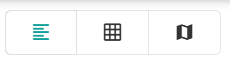

Vous pouvez trouver un espace dans PADS4 Workspace de trois façons : le parcourir dans une liste ou une grille, le filtrer avec le moteur de recherche, ou le trouver sur un plan interactif. Un *espace* est une salle, un bureau ou toute autre zone que vous pouvez réserver.

## Choisir une vue

Utilisez les icônes dans le coin supérieur droit de l'écran pour basculer entre les vues.

| Vue               | Utilisation                                                                                                                                                                   |
| ----------------- | ----------------------------------------------------------------------------------------------------------------------------------------------------------------------------- |
| **Vue en liste**  | Parcourir les espaces les uns en dessous des autres.                                                                                                                          |
| **Vue en grille** | Voir plus d'espaces sur un seul écran.                                                                                                                                        |
| **Vue plan**      | Voir où se trouvent les espaces dans un bâtiment et lesquels sont libres. Voir [Trouver un espace sur le plan](/modules/workspace/workspace-web-application/floor-plan-view). |

<Tip>
  Les espaces que vous marquez comme favoris apparaissent en premier dans la liste. Voir [Salle favorite](/fr/modules/workspace/workspace-web-application/FavouriteRoom).
</Tip>

## Trouver un espace

<Steps>
  <Step title="Ouvrir l'aperçu des espaces">
    Dans PADS4 Workspace, accédez à l'aperçu des espaces.
  </Step>

  <Step title="Affiner les résultats">
    Utilisez le moteur de recherche et les filtres pour n'afficher que les espaces qui correspondent à vos besoins. Par exemple, filtrez par capacité, bâtiment ou équipement disponible. Voir [Filtrer les espaces](/modules/workspace/workspace-web-application/filter-spaces).
  </Step>

  <Step title="Ouvrir un espace">
    Sélectionnez un espace dans les résultats pour voir ses détails, tels que son calendrier et son équipement. Voir [Consulter les détails d'un espace](/modules/workspace/workspace-web-application/space-details).
  </Step>

  <Step title="Réserver l'espace">
    Sélectionnez le bouton **+** dans le coin inférieur droit pour démarrer une réservation. Voir [Réserver un espace](/fr/modules/workspace/workspace-web-application/booking-a-space).
  </Step>
</Steps>
