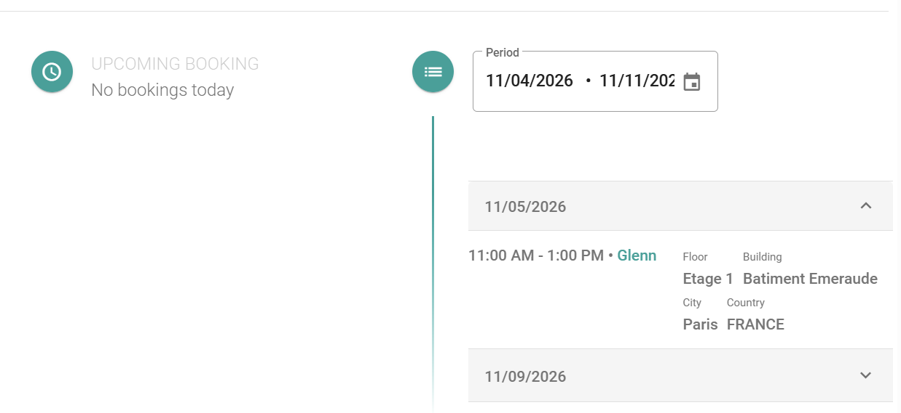

Recherchez un collègue pour voir où cette personne est planifiée pour travailler. Utilisez le résultat pour trouver le meilleur moment et endroit pour travailler ensemble.

## Avant de commencer

Votre administrateur doit activer la recherche de collègues. Voir [Recherche de collègues dans PADS4 Workspace](/modules/workspace/colleague-search-overview).

## Rechercher un collègue

<Steps>
  <Step title="Ouvrir l'outil de recherche">
    Dans le menu principal, sélectionnez **Rechercher des collègues**.
  </Step>

  <Step title="Sélectionner un collègue">
    Dans le répertoire à gauche, trouvez le collègue, puis sélectionnez le nom.
  </Step>

  <Step title="Sélectionner une période">
    Sélectionnez la période que vous souhaitez consulter.
  </Step>
</Steps>

<Check>
  Vous voyez les réservations d'espace de travail et la disponibilité du collègue pendant la période que vous avez sélectionnée.
</Check>
