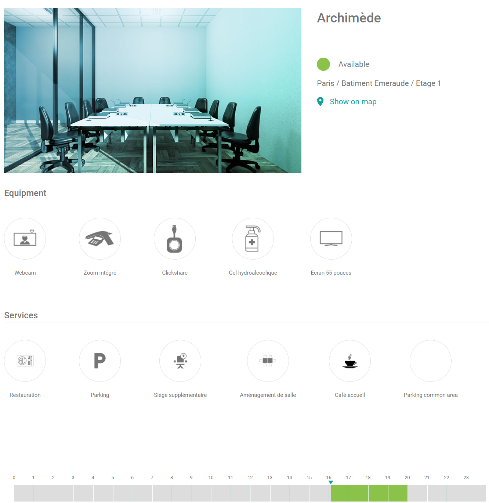

Ouvrez les détails d'un espace pour vérifier s'il correspond à votre réservation. Vous voyez ce que l'espace offre et quand il est libre, sans démarrer une réservation.

## Ouvrir les détails

Dans la liste des espaces, sélectionnez un espace.

## Ce que montrent les détails

| Détail                       | Description                                                                            |
| ---------------------------- | -------------------------------------------------------------------------------------- |
| **Nom**                      | Le nom de l'espace.                                                                    |
| **Photo ou illustration**    | Une image de l'espace.                                                                 |
| **Emplacement**              | Où se trouve l'espace.                                                                 |
| **Statut de disponibilité**  | Si l'espace est libre ou réservé.                                                      |
| **Calendrier de la salle**   | Les réservations de l'espace dans le temps. Utilisez-le pour trouver un créneau libre. |
| **Équipement**               | L'équipement dans l'espace, par exemple un projecteur.                                 |
| **Services supplémentaires** | Les services que vous pouvez ajouter à une réservation, par exemple la restauration.   |

{/* SCREENSHOT: PADS4 Workspace, the details of a room, showing the calendar, equipment, and services. */}

Votre administrateur décide des équipements et services dont dispose un espace. 

<Note>
  Si un équipement dans un espace est signalé comme défectueux, l'élément est masqué dans les détails. Il réapparaît lorsqu'il est marqué comme réparé. Voir [Équipement défectueux](/fr/modules/workspace/workspace-admin/defective-equipment).
</Note>

## Étapes suivantes

* Pour démarrer une réservation, voir [Réserver un espace](/fr/modules/workspace/workspace-web-application/booking-a-space).
* Pour garder un espace en haut de votre liste, voir [Favourite Room](/fr/modules/workspace/workspace-web-application/FavouriteRoom).
