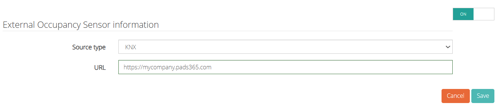

Pour activer KNX, effectuez les étapes suivantes :

1. Activez le bouton bascule sur ON.
2. Sélectionnez KNX comme type de source.
3. Entrez l'URL du point de terminaison KNX.
   <Frame>
     
   </Frame>
4. Cliquez sur Enregistrer.
