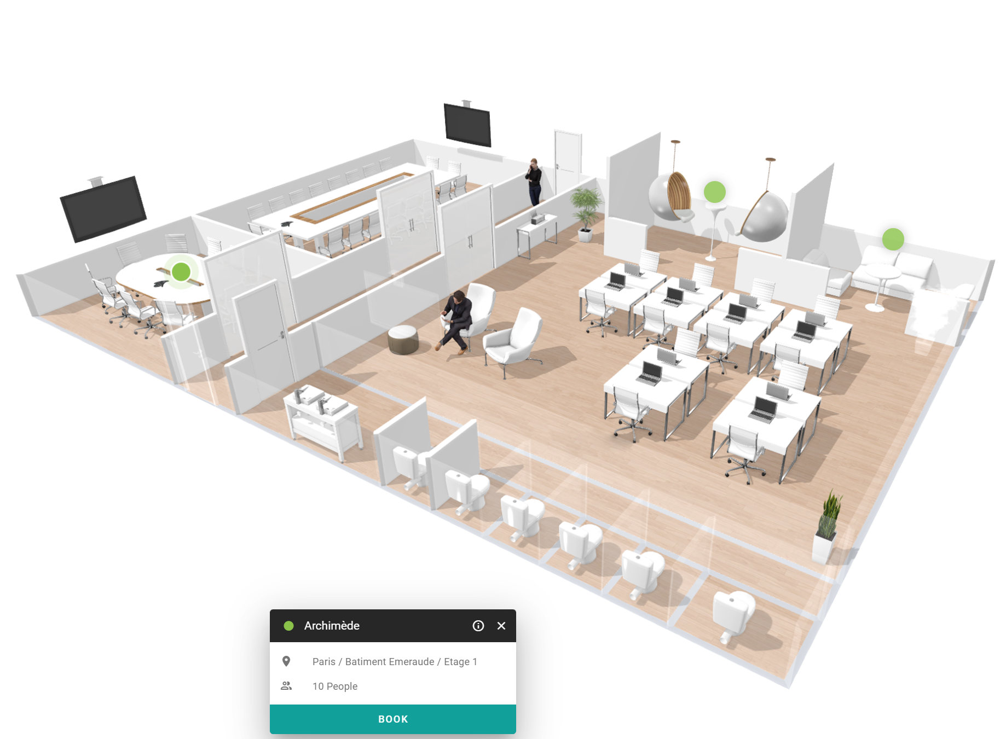

The floor plan view shows the layout of a floor with a button for each room. Use it when you know where you want to be, for example near your team, and you want to see which rooms are free there.

<Info>
  A floor plan is available only for floors where a floor map is added. Rooms without a position on the floor map do not appear on it. 
</Info>

## Open the floor plan

<Steps>
  <Step title="Open the floor plan view">
    In the space overview, select the floor plan icon in the upper-right corner of the screen.
  </Step>
  <Step title="Choose a building and floor">
    Select the building and the floor that you want to see. 
  </Step>
  <Step title="Select a room">
    Select the button of a room on the floor plan to see its details. See [View space details](/modules/workspace/workspace-web-application/space-details).
  </Step>
</Steps>

{/* SCREENSHOT: PADS4 Workspace, the floor plan view with room buttons on a floor map. */}

Rooms that your administrator set to inactive are temporarily unavailable. 

## Related

- [Search for a space](/modules/workspace/workspace-web-application/searching-for-a-space)
- [Filter spaces](/modules/workspace/workspace-web-application/filter-spaces)
- [Booking a space](/modules/workspace/workspace-web-application/booking-a-space)
