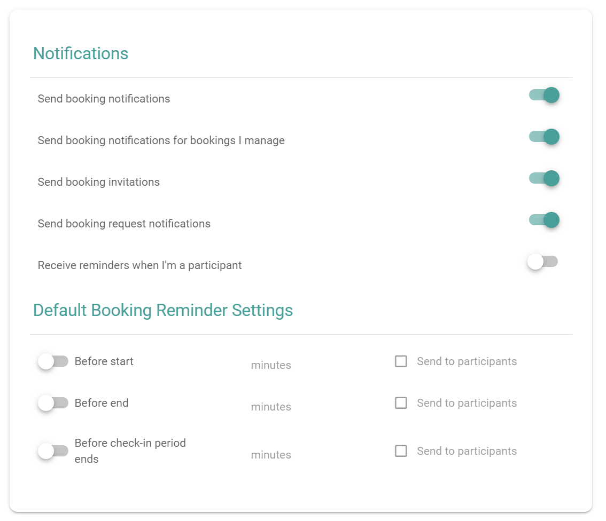

PADS4 Workspace notifies you about your bookings. You choose which notifications you receive, and you set the default reminders for your bookings.

## Before you begin

Your administrator sets default notification settings for all users. 

## Open the settings

In the main menu, select **Settings**. The notification settings are in the **Notifications** section, and the reminder settings are in the **Default Booking Reminder Settings** section.

<Frame caption="The Notifications and Default Booking Reminder Settings sections">
  
</Frame>

## Choose your notifications

Turn each switch on or off.

| Setting | Description |
| --- | --- |
| **Send booking notifications** | Sends you notifications about your bookings. |
| **Send booking notifications for bookings I manage** | Sends you notifications about bookings in rooms that you manage. |
| **Send booking invitations** | Sends invitations for your bookings. |
| **Send booking request notifications** | Sends you notifications about booking requests. |
| **Receive reminders when I'm a participant** | Sends you reminders for bookings where you are a participant and not the organizer. |

## Set the default booking reminders

Default reminders apply to the bookings that you make. For each reminder, set when PADS4 Workspace sends it, and who receives it.

| Reminder | Sent |
| --- | --- |
| **Before start** | Before the booking starts. |
| **Before end** | Before the booking ends. |
| **Before check-in period ends** | Before the check-in period of the booking ends. |

<Steps>
  <Step title="Turn on the reminder">
    Turn on the switch for the reminder that you need.
  </Step>
  <Step title="Enter the number of minutes">
    Enter how many minutes before the event the reminder is sent.
  </Step>
  <Step title="Choose the recipients">
    (Optional) Select **Send to participants** to send the reminder to the participants of the booking too.
  </Step>
</Steps>

You can also set reminders for one booking only. See [Set reminders for a booking](/modules/workspace/booking-reminders).
