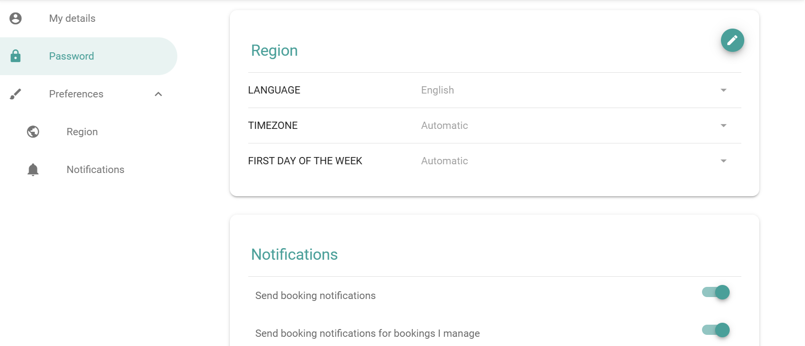

Account settings contain your personal preferences and basic information for PADS4 Workspace. You change them for your own account only.

## Open the account settings

In the main menu, select **Settings**. 

## Settings you can view or change

| Setting | Description |
| --- | --- |
| **Login Information** | Shows how you sign in. You cannot change it if you sign in with single sign-on (SSO). |
| **Password** | Changes your password. You can change it only if you do not use SSO. See [Change your password](/modules/workspace/change-your-password). |
| **Language** | The language of the PADS4 Workspace interface. Select the language that you prefer. |
| **Notifications** | Turns in-app and email notifications on or off. See [Notifications and default reminders](/modules/workspace/account-notifications). |
| **Reminders** | Your default reminder settings. See [Notifications and default reminders](/modules/workspace/account-notifications). |

<Note>
  If you sign in with SSO, the **Login Information** and **Password** fields are turned off for security and compliance reasons. Your organization manages these through its identity provider.
</Note>
