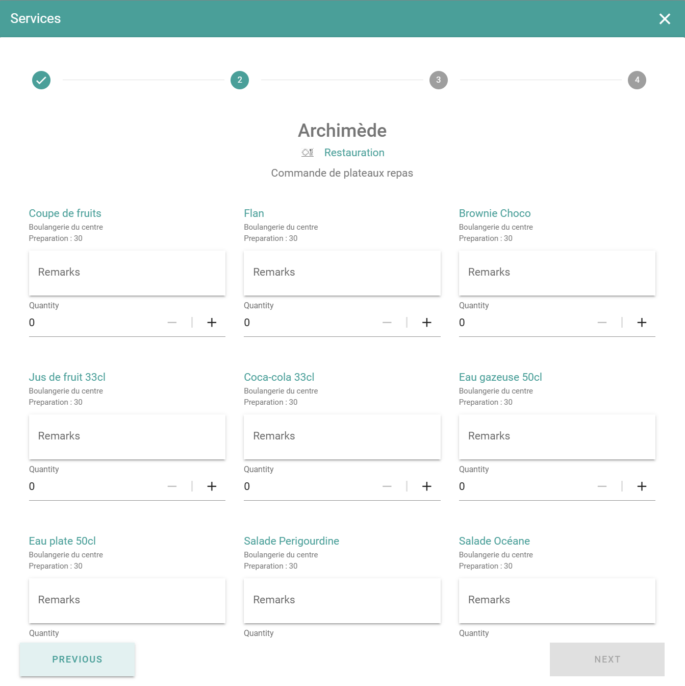

Add services to a booking when the meeting needs more than the room. Examples are catering, AV support, or a room setup.

## Before you begin

Your administrator decides which services exist, and for which rooms. If you do not see a service, ask your administrator. See [Additional services](/modules/workspace/workspace-admin/additional-services).

## Add a service

<Steps>
  <Step title="Open the services">
    In the booking window, select **Add Additional Services**.
  </Step>
  <Step title="Select the services">
    Select the services that you need from the available options.
  </Step>
  <Step title="Enter the quantity and a comment">
    Enter the quantity for each service. If the service allows comments, enter a comment, for example a dietary note for catering.
  </Step>
  <Step title="Confirm the services">
    Select **Confirm** to attach the services to the booking.
  </Step>
  <Step title="Save the booking">
    Select **Save**.
  </Step>
</Steps>

PADS4 sends the service request to the email address that your administrator set for the service.

## Related

- [Book a space](/modules/workspace/workspace-web-application/booking-a-space)
- [Additional services](/modules/workspace/workspace-admin/additional-services)
