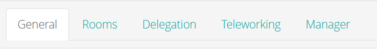
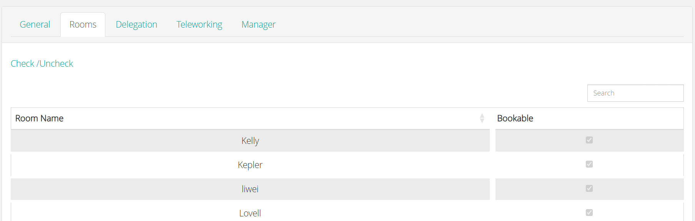
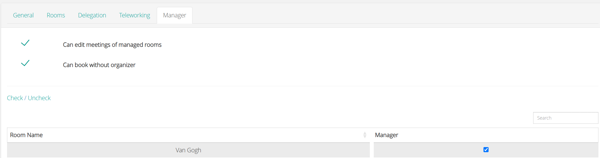

Use this page to look up the settings of a room user. To create a user, see [Add a room user](/modules/workspace/workspace-admin/add-a-room-user). To open the settings, go to **Room Users**, and then open the user.

A room user has five tabs.

<Frame caption="The tabs of a room user">
  
</Frame>

<table>
  <colgroup>
    <col width="141" />
    <col width="593" />
  </colgroup>
  <thead>
    <tr>
      <th>Tabs</th>
      <th>Use it to</th>
    </tr>
  </thead>
  <tbody>
    <tr>
      <td>**General**</td>
      <td>Enter the details of the user, and set options for booking.</td>
    </tr>
    <tr>
      <td>**Rooms**</td>
      <td>Choose which rooms the user can view and book.</td>
    </tr>
    <tr>
      <td>**Delegation**</td>
      <td>Allow the user to book on behalf of another user.</td>
    </tr>
    <tr>
      <td>**Teleworking**</td>
      <td>Set the remote work allowance of the user.</td>
    </tr>
    <tr>
      <td>**Manager**</td>
      <td>Give the user rights to the rooms that the user manages.</td>
    </tr>
  </tbody>
</table>

## General

<table>
  <colgroup>
    <col width="221" />
    <col width="515" />
  </colgroup>
  <thead>
    <tr>
      <th>Setting</th>
      <th>Description</th>
    </tr>
  </thead>
  <tbody>
    <tr>
      <td>**E-mail**</td>
      <td>The email address of the user.</td>
    </tr>
    <tr>
      <td>**Name**</td>
      <td>The last name of the user.</td>
    </tr>
    <tr>
      <td>**First Name**</td>
      <td>The first name of the user.</td>
    </tr>
    <tr>
      <td>**NFC Number**</td>
      <td>The number of the NFC card of the user. For example, a user can use an NFC access card to book a room quickly.</td>
    </tr>
    <tr>
      <td>**Teleworking**</td>
      <td>Select this option if the user works from an off-site location.</td>
    </tr>
    <tr>
      <td>**Prevent Room Booking**</td>
      <td>Select this option to stop the user from booking rooms.</td>
    </tr>
    <tr>
      <td>**Booking request enabled**</td>
      <td>Select this option to allow the user to send booking requests to their manager. See [Submit a booking request](/modules/workspace/booking-request).</td>
    </tr>
    <tr>
      <td>**Enable bookings overview**</td>
      <td>Turns on the **Manager** tab. The user can then edit meetings in the rooms for which the user is a manager.</td>
    </tr>
  </tbody>
</table>

## Rooms

Use the **Rooms** tab to choose the rooms that the user can use to book. The tab shows the list of rooms. Select the checkbox of each room that the user can book.

<table>
  <colgroup>
    <col width="153" />
    <col width="564" />
  </colgroup>
  <thead>
    <tr>
      <th>Control</th>
      <th>Description</th>
    </tr>
  </thead>
  <tbody>
    <tr>
      <td>**Checkbox**</td>
      <td>Select the checkbox of a room to allow the user to book the room. Clear it to remove the room.</td>
    </tr>
    <tr>
      <td>**Search**</td>
      <td>Finds a room in the list.</td>
    </tr>
    <tr>
      <td>**Check / Uncheck**</td>
      <td>Selects or clears the checkboxes of all rooms at once.</td>
    </tr>
  </tbody>
</table>

Select **Save** to apply your changes.

## Delegation

Use the **Delegation** tab to allow the user to make room bookings on behalf of another user. See [Book on behalf of someone else](/modules/workspace/delegation).

## Teleworking

Use the **Teleworking** tab to set the remote work allowance of the user: the maximum number of days that the user can work from home or another remote location. You can also create schedule periods, each with a start date, an end date, and the number of teleworking days that are allowed. See [Set the remote work allowance](/modules/workspace/workspace-admin/remote-work-allowance).

## Manager

Use the **Manager** tab to give the user rights to the rooms that the user manages. The tab has two settings and a list of rooms.

<Frame caption="The Manager tab of a room user">
  
</Frame>

<table>
  <colgroup>
    <col width="305" />
    <col width="413" />
  </colgroup>
  <thead>
    <tr>
      <th>Setting</th>
      <th>Description</th>
    </tr>
  </thead>
  <tbody>
    <tr>
      <td>**Can edit meetings of managed rooms**</td>
      <td>The user can edit the meetings in the rooms that the user manages.</td>
    </tr>
    <tr>
      <td>**Can book without organizer**</td>
      <td>The user can book a room without an organizer. Use this when the organizer is not known, or when the organizer does not have access to PADS4 Workspace. When the user books a room, the organizer of the booking is shown as **No organizer**.</td>
    </tr>
  </tbody>
</table>

The list shows the rooms and a Manager checkbox for each room. Select the checkbox for each room that the user manages.

<table>
  <colgroup>
    <col width="161" />
    <col width="546" />
  </colgroup>
  <thead>
    <tr>
      <th>Control</th>
      <th>Description</th>
    </tr>
  </thead>
  <tbody>
    <tr>
      <td>**Check / Uncheck**</td>
      <td>Selects or clears the **Manager** checkbox.</td>
    </tr>
    <tr>
      <td>**Search**</td>
      <td>Filters the list by room name.</td>
    </tr>
    <tr>
      <td>**Room Name**</td>
      <td>The name of the room.</td>
    </tr>
    <tr>
      <td>**Manager**</td>
      <td>Select this checkbox to make the user a manager of the room.</td>
    </tr>
    <tr>
      <td>**Previous** and **Next**</td>
      <td>Move between pages when the list has more rooms.</td>
    </tr>
  </tbody>
</table>

Select **Save** to apply your changes, or **Cancel** to close the tab without changes.

For the steps to give a user manager rights, see [Set up approvals and booking requests](/modules/workspace/workspace-admin/booking-approval-setup).
