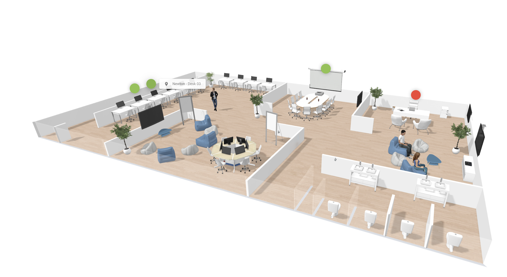

A group workspace is a set of shared desks close to each other. Use it when a department or project team wants to sit together.

## Before you begin

You need access rights to at least one shared desk. Your administrator sets these rights. See [Room user profile](/modules/workspace/workspace-admin/room-user-profile). 

## Book a group workspace

<Steps>
  <Step title="Open the group booking tool">
    In your calendar, select the green icon in the lower-right corner of the screen.
  </Step>
  <Step title="Start the booking">
    In the next menu, select **Space**.
  </Step>
  <Step title="Add the participants">
    Add the people for whom you reserve desks.
  </Step>
  <Step title="Select the desks">
    On the interactive floor plan on the right, select the desks that you want. Choose desks that are close to each other. A selected desk changes color.
  </Step>
  <Step title="Save the booking">
    Check that the desks appear in your reservation list, and then select **Save**.
  </Step>
</Steps>

<Check>
  The group booking appears in green in your calendar.
</Check>

## Related

- [Book a space](/modules/workspace/workspace-web-application/booking-a-space)
- [Find a space on the floor plan](/modules/workspace/Find-a-space-on-the-floor-plan)
- [My calendar](/modules/workspace/workspace-web-application/my-calendar)
