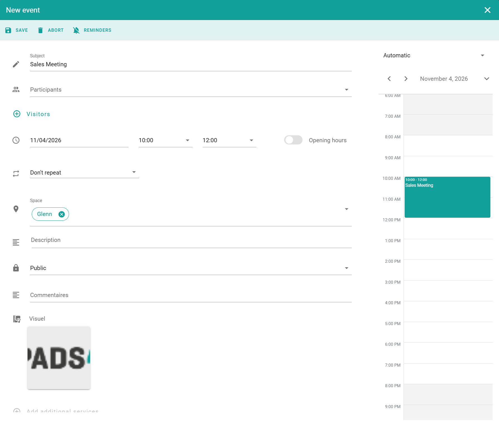

Book a room or desk when you need it for a meeting, a task, or a working day. After you save, the booking appears in your calendar, and all participants receive an email invitation.

## Before you begin

- Find the space that you want to book. See [Search for a space](/modules/workspace/workspace-web-application/searching-for-a-space).
- For a shared area such as a cafeteria, see [Book a common space](/modules/workspace/workspace-web-application/booking-a-common-space). For desks for a team, see [Book a group workspace](/modules/workspace/workspace-web-application/booking-a-group-workspace).

## Book a space

<Steps>
  <Step title="Start the booking">
    Select the space, and then select the **\+** button in the lower-right corner of the screen. The booking window opens.
  </Step>
  <Step title="Enter the booking details">
    Complete the fields that you need. See [Booking fields](#booking-fields).
  </Step>
  <Step title="Add options">
    (Optional) Add [participants and visitors](/modules/workspace/invite-participants-visitors), [reminders](/modules/workspace/booking-reminders), or [additional services](/modules/workspace/add-service).
  </Step>
  <Step title="Save the booking">
    Select **Save**.
  </Step>
</Steps>

<Check>
  The booking appears in your calendar. See [My calendar](/modules/workspace/workspace-web-application/my-calendar).
</Check>

<Info>
  Some rooms need approval. In that case, the booking stays _pending_ in your calendar until an approver confirms it. See [Workflows](/modules/workspace/workspace-web-application/Workflows).
</Info>

## Booking fields

| Field | Description |
| --- | --- |
| **Subject** | The title of the meeting or reservation. |
| **Participants** | The people in your organization that you invite. See [Invite participants and visitors](/modules/workspace/invite-participants-visitors). |
| **External Visitors** | Guests from outside your organization. See [Invite participants and visitors](/modules/workspace/invite-participants-visitors). |
| **Date** | The date and time of the booking. |
| **Space** | The room or desk that you book. |
| **Teams Meeting** | Creates a Microsoft Teams meeting link for the booking (optional). |
| **Description** | More details about the meeting. |
| **Public or Private** | If you select **Private**, the name of the organizer and the subject are hidden on room displays and in public lists. |
| **Comments** | Notes or instructions for the booking (optional). |
| **Visual** | An image that can appear on room panels or on digital signage. |
| **Additional Services** | Extra services, such as catering or equipment. See [Add services to a booking](/modules/workspace/add-service). |

<Note>
  Your administrator can turn on Teams meetings for all bookings by default. This works for rooms that are connected to Exchange only. 
</Note>
