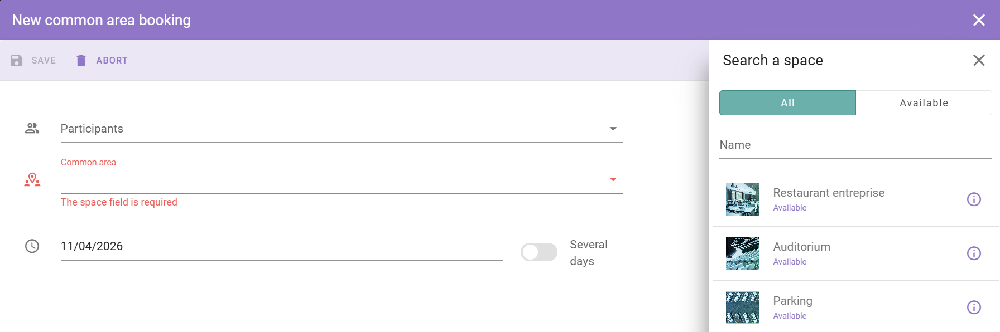

Common spaces are shared areas in your building. Examples are a company cafeteria, a gym, a lounge, or a collaboration zone. You book a spot in the area, for example a lunch slot or a gym session.

## Book a common space

<Steps>
  <Step title="Open your calendar">
    In the main menu, select **Calendar**.
  </Step>
  <Step title="Open your reservations">
    Select **My Reservations** to see your current and past bookings.
  </Step>
  <Step title="Start a new booking">
    Select the **\+** button in the lower-right corner of the screen.
  </Step>
  <Step title="Select the common space type">
    Select the purple icon for common spaces, and then select **Common Space** from the list of space types.
  </Step>
  <Step title="Select the space and the option">
    In the panel on the right, select the common space, for example the cafeteria. Then select the option for that space, for example a lunch slot or a gym session.
  </Step>
  <Step title="Save the booking">
    Select **Save**.
  </Step>
</Steps>

<Check>
  The reservation appears in your calendar.
</Check>

## Related

- [Book a space](/modules/workspace/workspace-web-application/booking-a-space)
- [Common area](/modules/workspace/workspace-admin/common-area)
- [My calendar](/modules/workspace/workspace-web-application/my-calendar)
