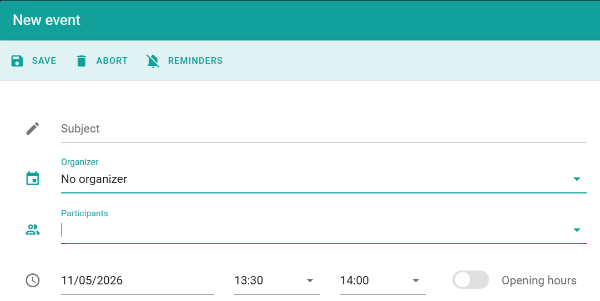

Use a booking when you book a room for someone, and the organizer of the meeting is not known, or the organizer has no PADS4 Workspace account. You make the booking in the same way as other bookings, but you select **No organizer**.

## Book a room without an organizer

<Steps>
  <Step title="Open the overview">
    In PADS4 Workspace, go to **Calendar**, and then select **Overview**.
  </Step>
  <Step title="Start the booking">
    Start a new booking in the same way as you book a room. See [Book a space](/modules/workspace/booking-a-space).
  </Step>
  <Step title="Select No organizer">
    In the organizer field, select **No organizer**.
  </Step>
  <Step title="Enter the details">
    Select the room and the time, and enter the other details of the booking. You can add participants.
  </Step>
  <Step title="Save the booking">
    Select **Save**.
  </Step>
</Steps>

<Check>
  The booking appears in the calendar. The organizer of the booking is shown as **No organizer**.
</Check>

## Related

- [Room user settings](/modules/workspace/workspace-admin/room-user-settings)
- [Book a space](/modules/workspace/booking-a-space)
- [Advanced booking options](/modules/workspace/advanced-booking)
