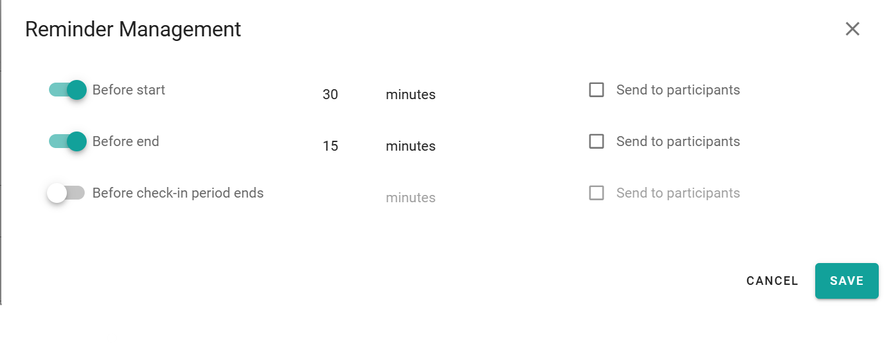

Reminders tell you, and optionally the participants, when a booking starts or ends, or when it is time to check in. Set them in the booking window.

## Reminder types

| Reminder | Sent |
| --- | --- |
| **Start** | Before the booking starts. |
| **End** | Before the booking ends. |
| **Check-in** | Before the check-in time. |

## Set a reminder

<Steps>
  <Step title="Open the reminders">
    In the booking window, select **Reminders**.
  </Step>
  <Step title="Turn on a reminder">
    Turn on the reminder that you need.
  </Step>
  <Step title="Set the time">
    Enter how many minutes before the event PADS4 sends the reminder.
  </Step>
  <Step title="Choose the recipients">
    Choose whether participants also receive the reminder.
  </Step>
  <Step title="Save the booking">
    Select **Save**.
  </Step>
</Steps>

<Note>
  Your administrator sets the default notification settings for all bookings. Your reminders replace these defaults for this booking.
</Note>

## Related

- [Book a space](/modules/workspace/workspace-web-application/booking-a-space)
- [Workspace application settings](/Workspace/Administrator/Workspace-Application-Setting)
