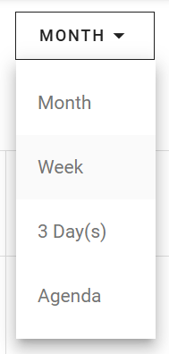

My calendar has four views. Use a larger view to plan ahead, and a smaller view to see the details of the days that are near.

## Switch the view

At the top of the screen, use the view selector to select a view.

## Available views

| View | Use it to |
| --- | --- |
| **Monthly View** | See your whole month at once. |
| **Weekly View** | Plan in detail. It shows your schedule for a full week. |
| **3-Day View** | Plan for the short term. It shows three days in a row. |
| **Agenda View** | See your upcoming activities in a list, in chronological order, for a quick overview. |

## Related

- [My calendar](/modules/workspace/my-calender)
- [Calendar entries and colors](/modules/workspace/calendar-entries)
