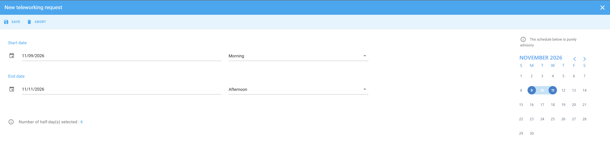
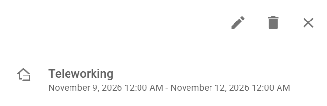

Declare the days that you work remotely, so that your calendar shows where you work. PADS4 Workspace subtracts the days from your yearly allowance.

## Before you begin

Your administrator must turn on remote work, and can give you an allowance of remote work days per year. See [Remote work in PADS4 Workspace](/modules/workspace/workspace-web-application/remote-work-overview).

## Declare remote work

<Steps>
  <Step title="Open the remote work tool">
    In your calendar, select the blue icon in the lower-right corner of the screen.
  </Step>
  <Step title="Select the remote work days">
    Select the date or the range of days that you work remotely. The screen shows the number of half-days that you selected. At the bottom left, you see how many remote work days you have left this year.
  </Step>
  <Step title="Save the declaration">
    Select **Save**.
  </Step>
</Steps>

<Check>
  The declaration appears in blue in your calendar, for the period that you selected.
</Check>

<Note>
  If you select more days than your remaining allowance, PADS4 Workspace shows a warning that your request exceeds your allowance. [TODO: confirm whether you can still save the declaration after the warning]
</Note>

## Change or delete a remote work declaration

If your plans change, you can change the days of a declaration or delete the declaration.

<Steps>
  <Step title="Open the declaration">
    In your calendar, select the blue **Teleworking** entry. [TODO: confirm how to open the entry] The details of the declaration show the period.
  </Step>
  <Step title="Change or delete the declaration">
    - To change the days, select the pencil icon, change the dates, and then save your changes.
    - To delete the declaration, select the trash icon.
  </Step>
</Steps>

## Related

- [Remote work in PADS4 Workspace](/modules/workspace/workspace-web-application/remote-work-overview)
- [My calendar](/modules/workspace/workspace-web-application/my-calendar)
- [Report absence](/modules/workspace/workspace-web-application/reporting-absence)
