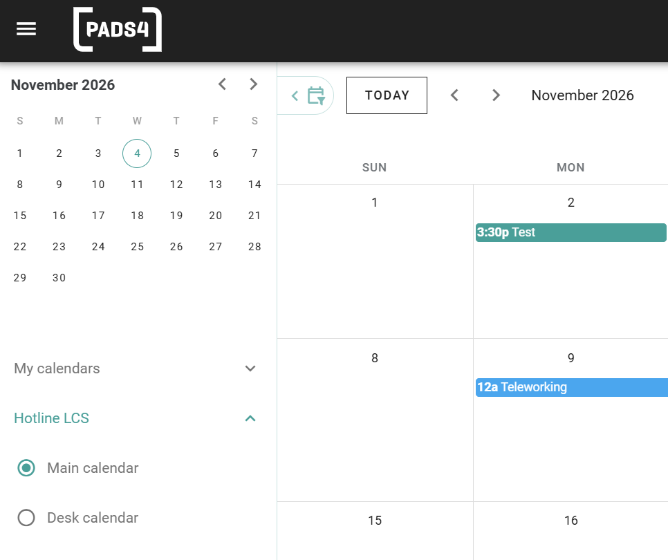

With _delegation_, one user can manage bookings for another user. This is useful for executive assistants who manage a calendar, or for team leads who book for a team.

## How delegation works

An administrator gives you access to the calendar of another user. The name of that user then appears in the list of calendars on the left side of PADS4 Workspace. When you select the calendar, you can view it and book through it.

## Before you begin

Delegation is set up by an administrator. In the admin interface, go to **Room Users**, open the user, and use the **Delegation** section to allow another user to book on behalf of this user. See [Users](/modules/workspace/workspace-admin/users). 

## Book on behalf of another user

<Steps>
  <Step title="Open the calendar list">
    In PADS4 Workspace, go to your calendar. On the left, below the monthly overview, you see **My calendars** and the name of each user for whom you can book.
  </Step>
  <Step title="Select the calendar of the user">
    Expand the name of the user, and then select **Main calendar**. The calendar shows the bookings and the remote work of that user.
  </Step>
  <Step title="Make the booking">
    Book a space in the usual way. The booking is made for the user whose calendar you selected. See [Book a space](/modules/workspace/book-a-space).
  </Step>
</Steps>

<Frame caption="The calendars of a delegate.">
  
</Frame>

Under the name of the user, you can choose between two calendars:

| Calendar | Shows |
| --- | --- |
| **Main calendar** | The bookings and declarations of the user, such as meetings and remote work. |
| **Desk calendar** | The calendar of the desk of the user. |

Use the **Location** filter below the calendars to limit what you see to one location. 

<Check>
  The booking appears in the calendar of the user for whom you booked. 
</Check>
