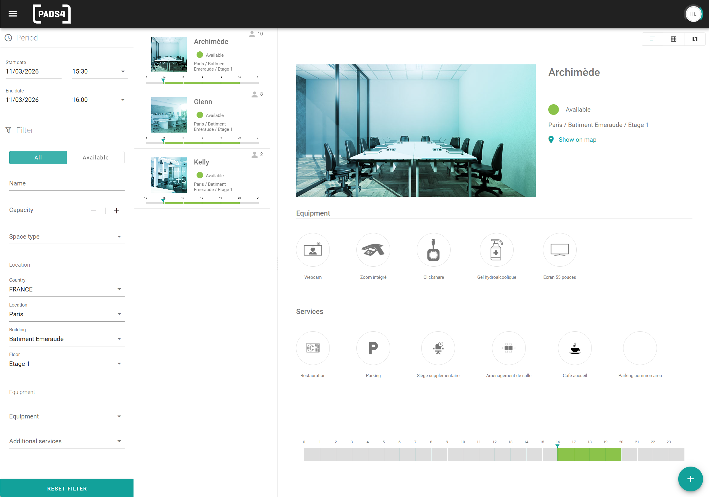

The search engine shows only the spaces that match your criteria. Use it when the list of spaces is long, or when a booking has specific requirements, such as a minimum capacity or a projector.

## Available filters

| Filter | Use it to find spaces |
| --- | --- |
| **Name** | With a specific name, or part of a name. |
| **Capacity** | That fit a number of people. |
| **Space Type** | Of a specific type, for example a room or a desk. |
| **Country** | In a country. |
| **City** | In a city. |
| **Building** | In a building. |
| **Floor** | On a floor. |
| **Available Equipment** | With specific equipment, for example a projector or a display. |
| **Available Services** | That offer specific additional services, for example catering. |

The location filters follow the location structure that your administrator created: country, city, building, and floor. Your administrator also decides which equipment and services exist.

## Filter the list of spaces

<Steps>
  <Step title="Open the search engine">
    In the space overview, go to the search engine.
  </Step>
  <Step title="Set the filters">
    Enter or select a value for each filter that you want to use. You can combine filters. 
  </Step>
  <Step title="Open a space">
    Select a space in the results to see its details. See [View space details](/modules/workspace/workspace-web-application/space-details).
  </Step>
</Steps>
