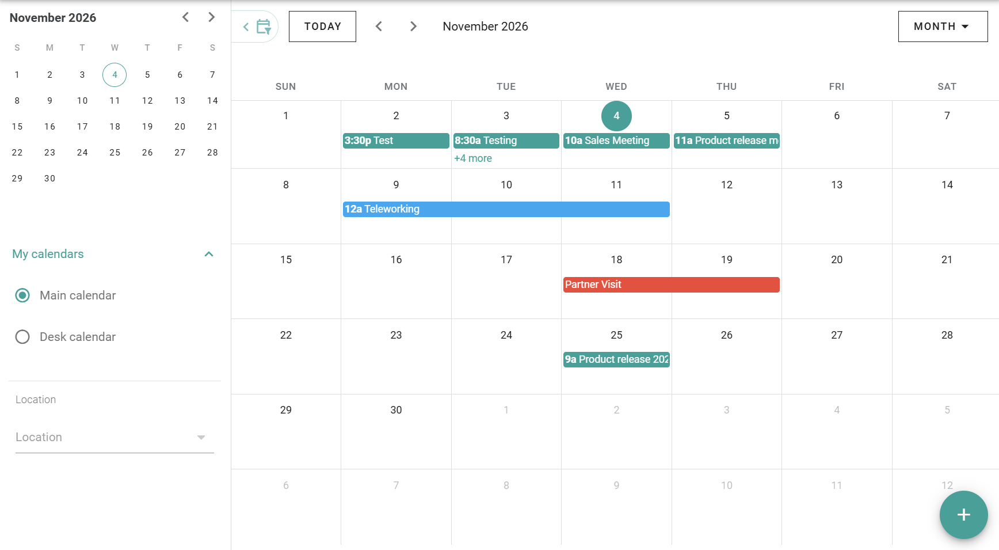

My calendar shows everything that you planned in PADS4 Workspace. You also start new bookings and declarations from it.

## What My calendar shows

| Entry | See also |
| --- | --- |
| Room bookings | [Book a space](/modules/workspace/booking-a-space) |
| Common space reservations | [Book a common space](/modules/workspace/booking-a-common-space) |
| Group workspace bookings | [Book a group workspace](/modules/workspace/booking-a-group-workspace) |
| Remote work declarations | [Declare remote work](/modules/workspace/declaring-remote-work) |
| Absence periods | [Report absence](/modules/workspace/report-absence) |

If a desk or office is assigned to you, you also see its calendar. See [Absence in PADS4 Workspace](/modules/workspace/absence-overview).

## Move through your calendar

Scroll to move through months, weeks, or days. To change how much of your calendar you see, select a view. See [Calendar views](/modules/workspace/calendar-view).

## Start a booking or a declaration

Use the **\+** button in the lower-right corner of the screen to start an action, such as a booking, a remote work declaration, or an absence. The icons and colors for each type are in [Calendar entries and colors](/modules/workspace/calendar-entries).

## Open, change, or delete an entry

Select an entry to see its details. For remote work and absences, the details show the period and the icons to edit, delete, and close.

## Related

- [Calendar views](/modules/workspace/calendar-view)
- [Calendar entries and colors](/modules/workspace/calendar-entries)
