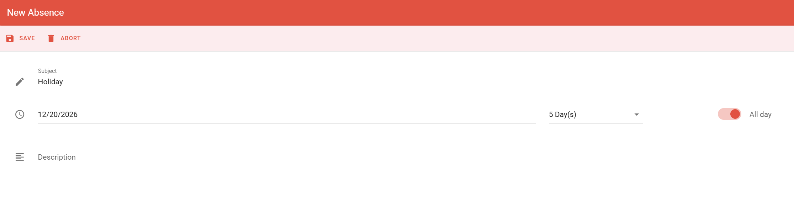

Report your absence to release your assigned desk or office for the days that you are away. Other people can then book the space.

## Before you begin

You need a desk or office that is assigned to you. If you have one, its calendar appears next to your own calendar. See [Absence in PADS4 Workspace](/modules/workspace/absence-overview).

## Report an absence

<Steps>
  <Step title="Open your calendar">
    In PADS4 Workspace, go to your calendar. If you have an assigned space, you see its calendar too. This shows when you are present or absent.
  </Step>
  <Step title="Open the absence tool">
    Select the **\+** button in the lower-right corner of the screen, and then select the red icon.
  </Step>
  <Step title="Select the absence period">
    In the calendar, select the start date and the end date of your absence. You can select several days at once.
  </Step>
  <Step title="Save the absence">
    Select **Save**.
  </Step>
</Steps>

<Check>
  The absence appears in red in your main calendar. Administrators can see it, and your space is free for other people to book.
</Check>

## Change or delete an absence

If your plans change, you can change the days of an absence or delete the absence.

<Steps>
  <Step title="Open the absence">
    In your calendar, select the red absence entry. The details show the period of the absence.
  </Step>
  <Step title="Change or delete the absence">
    - To change the days, select the pencil icon, change the dates, and then save your changes.
    - To delete the absence, select the trash icon.
  </Step>
</Steps>

## Related

- [Absence in PADS4 Workspace](/modules/workspace/absence-overview)
- [Declare remote work](/modules/workspace/declaring-remote-work)
- [My calendar](/modules/workspace/my-calender)
