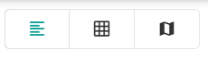

You can find a space in PADS4 Workspace in three ways: browse it in a list or grid, filter it with the search engine, or find it on an interactive floor plan. A _space_ is a room, desk, or other area that you can book.

## Choose a view

Use the icons in the upper-right corner of the screen to switch between views.

| View | Use it to |
| --- | --- |
| **List view** | Scan spaces one below the other. |
| **Grid view** | See more spaces on one screen. |
| **Floor plan view** | See where spaces are in a building and which ones are free. See [Find a space on the floor plan](/modules/workspace/workspace-web-application/floor-plan-view). |

<Tip>
  Spaces that you mark as favorite appear first in the list. See [Favourite Room](/modules/workspace/workspace-web-application/FavouriteRoom).
</Tip>

## Find a space

<Steps>
  <Step title="Open the space overview">
    In PADS4 Workspace, go to the space overview.
  </Step>
  <Step title="Narrow down the results">
    Use the search engine and filters to show only the spaces that fit your needs. For example, filter by capacity, building, or available equipment. See [Filter spaces](/modules/workspace/workspace-web-application/filter-spaces).
  </Step>
  <Step title="Open a space">
    Select a space in the results to see its details, such as its calendar and equipment. See [View space details](/modules/workspace/workspace-web-application/space-details).
  </Step>
  <Step title="Book the space">
    Select the **\+** button in the lower-right corner to start a booking. See [Booking a space](/modules/workspace/workspace-web-application/booking-a-space).
  </Step>
</Steps>
