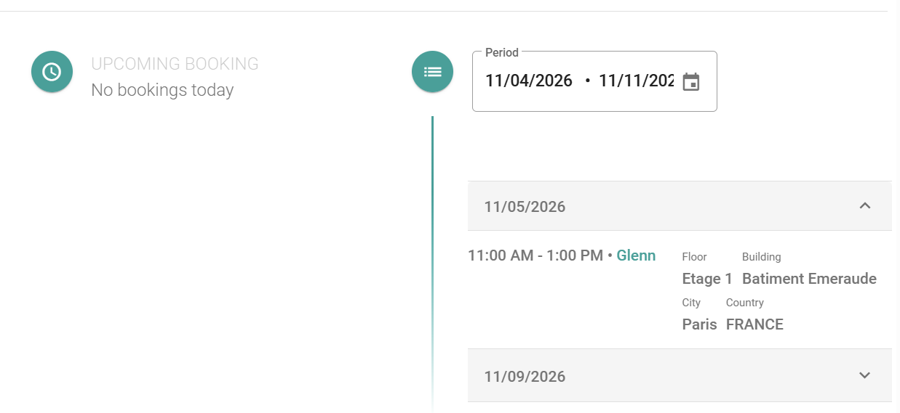

Search for a colleague to see where that person is scheduled to work. Use the result to find the best time and place to work together.

## Before you begin

Your administrator must turn on colleague search. See [Colleague search in PADS4 Workspace](/modules/workspace/colleague-search).

## Search for a colleague

<Steps>
  <Step title="Open the search tool">
    In the main menu, select **Search for Colleagues**.
  </Step>
  <Step title="Select a colleague">
    In the directory on the left, find the colleague, and then select the name.
  </Step>
  <Step title="Select a period">
    Select the time period that you want to see.
  </Step>
</Steps>

<Check>
  You see the workspace reservations and the availability of the colleague in the period that you selected.
</Check>
