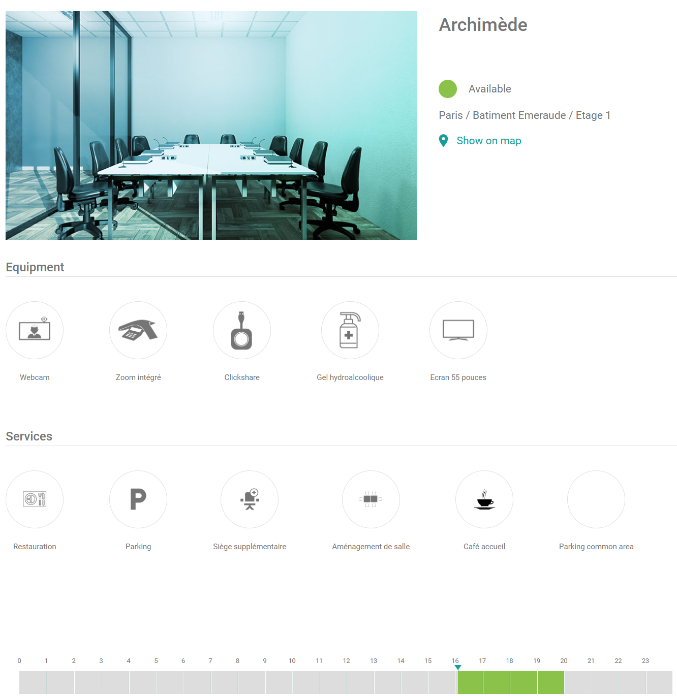

Open the details of a space to check whether it fits your booking. You see what the space offers and when it is free, without starting a booking.

## Open the details

In the list of spaces, select a space.

## What the details show

| Detail | Description |
| --- | --- |
| **Name** | The name of the space. |
| **Photo or illustration** | An image of the space. |
| **Location** | Where the space is. |
| **Availability status** | Whether the space is free or booked. |
| **Room calendar** | The bookings of the space over time. Use it to find a free time. |
| **Equipment** | The equipment in the space, for example a projector. |
| **Additional services** | The services that you can add to a booking, for example catering. |

{/* SCREENSHOT: PADS4 Workspace, the details of a room, showing the calendar, equipment, and services. */}

Your administrator decides which equipment and services a space has. 

<Note>
  If equipment in a space is reported as defective, the item is hidden in the details. It appears again when it is marked as repaired. See [Defective equipment](/modules/workspace/workspace-admin/defective-equipment).
</Note>

## Next steps

- To start a booking, see [Booking a space](/modules/workspace/workspace-web-application/booking-a-space).
- To keep a space at the top of your list, see [Favourite Room](/modules/workspace/workspace-web-application/FavouriteRoom).
